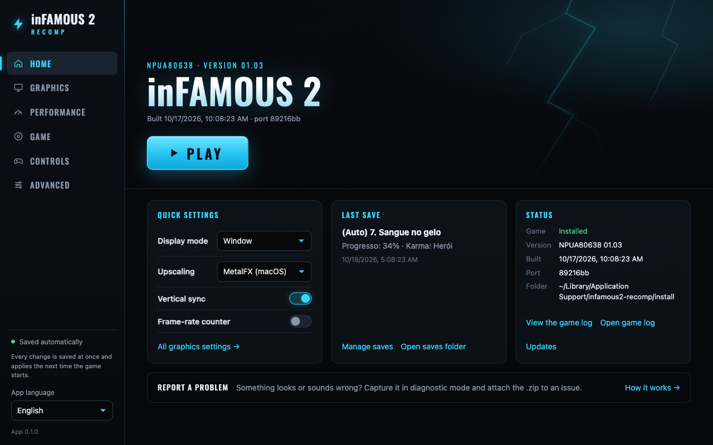

# inFAMOUS 2 — static recompilation for PC (macOS)

🌐 **English** · [Português (BR)](README.pt-BR.md)

A native port of **inFAMOUS 2** (PS3, digital release `NPUA80638`) to
**macOS/arm64**, built with static recompilation: the game's PowerPC and SPU
code is translated to C/C++ and compiled into a native executable, with
graphics on Metal. It is not an emulator.

**It boots, shows its menus and cutscenes, and New Marais is playable**, at
the game's own 30 fps cap on Apple silicon. Get the app from the
[**v0.2.0 alpha release**](https://github.com/erikomis/infamous2-recomp/releases/tag/v0.2.0)
and it rebuilds the game from your own copy ([how](#download-and-play)).

| | |
| --- | --- |
| [](docs/screenshots/01-boot-sucker-punch-logo.jpg)<br>Boot: the studio logos | [](docs/screenshots/02-main-menu.jpg)<br>3D main menu |
| [](docs/screenshots/03-intro-comic.jpg)<br>Comic-book intro (Bink video) | [](docs/screenshots/04-cutscene-sunset-docks.jpg)<br>Arriving in New Marais (in-engine cutscene) |
| [](docs/screenshots/05-cutscene-kuo.jpg)<br>Kuo on the pier (in-engine cutscene) | [](docs/screenshots/06-pier-gameplay.jpg)<br>Gameplay: the pier by day |
| [](docs/screenshots/07-street-amp.jpg)<br>The streets of New Marais, Amp in hand | [](docs/screenshots/08-street-corner.jpg)<br>Late afternoon in the city |
| [](docs/screenshots/09-dusk-neon-taxi.jpg)<br>Neon at dusk |  |

<sub>Frames from the port itself running on an Apple-silicon Mac (M4 Pro),
built from the player's own copy, at the game's 1280×720; subtitles are in
Brazilian Portuguese, the port's default dub. inFAMOUS 2 © Sony Interactive
Entertainment, developed by Sucker Punch Productions; shown only to document
the port.</sub>

Built on [ps3recomp](https://github.com/sp00nznet/ps3recomp) and, above all,
on [NoahBPeterson](https://github.com/NoahBPeterson/ps3recomp)'s **inFAMOUS 1
fork**, which brought the firmware LLE and the fixes that got the first game
running on the Mac. See [CREDITS.md](CREDITS.md).

> [!WARNING]
> **Alpha, not tested from start to finish yet.** The game runs from boot to
> the first missions in New Marais, only on Apple silicon macOS. Nobody has
> gone past 1% of the story yet, so later missions may break. What is missing
> is in [ROADMAP.md](ROADMAP.md).

> **This repository contains no game data, no firmware, no Sony keys and
> nothing translated from them.** Everyone generates all of that locally from
> their own legitimate copy. A fan project, not affiliated with Sony
> Interactive Entertainment or Sucker Punch Productions.

## Status

| | |
| --- | --- |
| Boot, firmware LLE, SPURS, Wwise audio (SPU jobs) | ✅ |
| Health warning, studio logos, Bink videos, loading screens | ✅ |
| 3D main menu, pause menu, options | ✅ |
| New game → comic-book intro → in-engine cutscenes | ✅ |
| Empire City prologue (the Beast, the freighter) | ✅ |
| New Marais: first missions, played in a window with a DualSense | ✅ |
| Performance | ✅ ~30 fps walking in New Marais (the game's own cap) in headless runs on Apple silicon: frames of 29.7–30.4 ms, ~33–36 fps of headroom. Windowed confirmation pending |
| Controller (DualSense tested; DualShock 4 and Xbox through SDL), rumble | ✅ |
| Keyboard and mouse (mouse camera, remappable) | 🧪 mapped, little tested in a window |
| Saves and trophies (in `~/Library/Application Support`), saves manager in the app | ✅ |
| Brazilian Portuguese dub and subtitles (default), other languages your copy ships, DLC | ✅ |
| The app: install, rebuild, play, settings, controls, saves, report a problem | ✅ [v0.2.0 alpha](https://github.com/erikomis/infamous2-recomp/releases/tag/v0.2.0) |
| Whole game | ❓ nobody has gone past 1% yet |
| Linux and Windows | ⏳ planned |

Details and next steps in [ROADMAP.md](ROADMAP.md).

## Download and play

You need an Apple-silicon Mac and your own copy of inFAMOUS 2 (the PSN
release `NPUA80638`, for example installed in [RPCS3](https://rpcs3.net) with
its `.rap` licence).

1. Download `infamous2-recomp_0.2.0_aarch64.dmg` from the
   [v0.2.0 release](https://github.com/erikomis/infamous2-recomp/releases/tag/v0.2.0)
   and drag the app to Applications. It is not notarized: the first time,
   right-click > Open (or System Settings > Privacy & Security > Open Anyway).
2. The app lists what your Mac still needs (Xcode Command Line Tools, a few
   Homebrew packages) and installs it with your OK.
3. Pick your game folder; the `.rap` is found on its own. Decryption uses
   RPCS3 if you have it, or your own key file and the PS3 firmware (a
   `dev_flash` folder or Sony's `PS3UPDAT.PUP`). No keys ship with the app.
4. **Install** (the first rebuild takes a few minutes), then **Play**.

After updating the app, the Updates card on Home offers **Rebuild the game**.
The release ships no game files: the app recompiles the game on your Mac.

## The app

[`launcher/`](launcher/README.md) is a desktop app (Tauri) that does all of
this without a terminal, in the game's own look: Home (your copy's art, PLAY,
quick settings, last save, status), Graphics, Performance, Game, Controls and
Advanced.

- **Install / rebuild** with a progress bar: checks and installs the tools,
  finds your copy and its `.rap`, decrypts with RPCS3 or without it.
- **Graphics:** window, fullscreen or borderless, screen, vsync, gamma,
  anisotropic filtering, FXAA, sharpening (CAS), MetalFX upscaling, fps
  counter.
- **Controls:** remap keyboard, mouse and controller, mouse camera,
  vibration; **audio** volume and output; **game language** (the ones your
  copy ships).
- **Saves:** list, back up, restore, import/export with RPCS3, `.zip`.
- **Debug mode** (Advanced > Debug mode): play normally while the game logs
  what goes wrong (missing functions, shader/texture failures, GPU stalls,
  SPU faults, audio falling behind, files it cannot open, frame-rate drops)
  and keeps a timed index of the session; press **Capture this frame** when
  something looks wrong. Afterwards **Analyse** runs
  `infamous2-lle/tools/log_triage.py` on the session and lists the top
  issues (also in `triage.md` in the session folder, for a developer or an
  agent to go through), and **Create .zip** packs it all for an issue.
  Details in [launcher/README.md](launcher/README.md#debug-mode-report-a-problem).
  Plus a **game log viewer** that follows the log live.
- **Updates card:** tells when a newer release is out or the installed game
  is older than the app's sources, and offers a rebuild.

| | |
| --- | --- |
| [](launcher/docs/screenshots/home.en.png) | [](launcher/docs/screenshots/graphics.png) |

CI builds it for macOS, Windows and Linux on every change (the game itself
builds only on macOS so far); the installers are not signed yet.

## Known problems

- In some close-up views at dusk the occlusion-volume passes turned whole
  facades (and Cole) black; `run.sh` skips them for now (only the soft
  contact darkening near props is lost) while their math is checked.
  `PS3RECOMP_ENG_SKIP_FP=` (empty) draws them again.
- Rarely, an SPU running the Edge geometry job faults and the game stops
  (about 1 run in 8 before the latest runtime changes; none in the last 17
  test runs). Diagnosed down to a register clobbered inside an atomic loop,
  not fixed for certain yet.
- Windows and Linux are not supported yet.
- With less than about 3 GB free on the disk the game shows a "not enough
  space" error at boot, which in the window is just a black screen.

## Work in progress

What is being worked on now (details in [ROADMAP.md](ROADMAP.md)):

- An **in-game overlay menu**, to change settings without leaving the game.
- A **live A/B toggle file**: the running game re-reads a text file and
  switches options on the fly, for fair before/after comparisons in one run.
- A **fifth round of pull requests** to [ps3recomp](https://github.com/sp00nznet/ps3recomp)
  with this port's toolkit fixes.
- **Adopting upstream fixes:** ps3recomp #358, #340, #326, #349, #360, #366
  and the log-cap fix from issue #364 are in since v0.2.0; more as they land.

## Building from source

The app does all of this for you; by hand, from a terminal:

### What you need

- An Apple Silicon Mac (tested on an M4 Pro, macOS 27).
- A legitimate copy of inFAMOUS 2 installed in [RPCS3](https://rpcs3.net),
  with its license (`.rap`) and the PS3 firmware installed there.
- Xcode Command Line Tools and Homebrew:

```sh
brew install cmake ninja sdl2 glslang spirv-cross spirv-tools python@3.12
python3.12 -m venv .venv
```

### Building

```sh
git clone https://github.com/erikomis/infamous2-recomp.git
cd infamous2-recomp
tools/setup_toolkit.sh                        # toolkit in ./ps3recomp-fork
.venv/bin/pip install -r ps3recomp-fork/requirements.txt
```

Then one command does the rest (decrypt, translate, compile), from your
copy and its licence:

```sh
python3 infamous2-lle/tools/rebuild.py --game "<RPCS3>/dev_hdd0/game/NPUA80638" --rap <NPUA80638...rap>
```

`--dry-run` lists the steps and checks every prerequisite first. By default
the EBOOT and the firmware are decrypted with RPCS3; without RPCS3, pass your
own key file (scetool format) with `--keys KEYFILE`, and the firmware as
Sony's `PS3UPDAT.PUP` with `--firmware PS3UPDAT.PUP`. No keys ship with this
repository. The manual recipe is in
[`infamous2-lle/README.md`](infamous2-lle/README.md#rebuilding).

Translation takes a few minutes and compiling ~80 s on an M4 Pro.

## Playing from the terminal

```sh
cd infamous2-lle
./run.sh
```

A controller (DualSense tested) works out of the box. Keyboard and mouse add
on top of it:

| Key | PS3 |
| --- | --- |
| W A S D | left stick |
| I J K L or mouse | right stick (camera) |
| Arrow keys | D-pad |
| Space | ✕ |
| Q / E / R | ○ / □ / △ |
| U / O | L1 / R1 |
| Y / P | L2 / R2 |
| G / H | L3 / R3 |
| Return / Tab | START / SELECT |
| Left / right / middle mouse button | R1 / R2 / L1 |

The mouse is tuned with `PS3_MOUSE_SENS`, `PS3_MOUSE_INVERT_Y=1`,
`PS3_MOUSE_INVERT_X=1` and `PS3_MOUSE_DEADZONE`; `PS3_MOUSE=0` turns it off. A
click in the game captures it (the cursor hides and the camera follows the
mouse); Esc or Cmd releases it, and so does switching to another app.
`PS3_MOUSE_CAPTURE=0` goes back to the uncaptured camera.

Every binding above can be changed in a controls file: the launcher's
**Controls** screen writes it, or write it by hand at
`~/Library/Application Support/infamous2-recomp/input.toml` (`input.ini` also
works; `PS3_INPUT_MAP=<file>` picks another one, `PS3_INPUT_MAP=` none).
Anything the file leaves out keeps the layout above (the mouse's side
buttons press L1, like the middle one), except that an input the file binds
leaves the controls it does not mention: `cross = "Q"` takes Q off ○ (list it
under both to keep both). Names are not case-sensitive, and an unknown one
is reported once in the log and ignored.

```toml
[keyboard]                  # PS3 control = keys
cross    = "Space"
circle   = "F"
start    = "Return, KeypadEnter"   # several keys
l3       = "Shift"
r3       = ""                      # unbound

[mouse_buttons]             # PS3 control = mouse buttons
r1   = "Left"
up   = "WheelUp"            # each wheel notch is one press
down = "WheelDown"
l1   = "Button4"

[mouse]                     # the environment variables above win over these
camera      = true
sensitivity = 1.5
invert_x    = false
invert_y    = false
deadzone    = 30
capture     = true

[controller]                # PS3 control = SDL controller inputs
cross  = "a"                # Cross on a DualSense, A on an Xbox pad
circle = "b"
select = "touchpad"
```

- PS3 controls: `cross circle square triangle l1 r1 l2 r2 l3 r3 start select`,
  `up down left right` (D-pad), `ls_up ls_down ls_left ls_right` and
  `rs_up rs_down rs_left rs_right` (sticks).
- Keys, by their place on a US Mac keyboard: `A`-`Z`, `0`-`9`, `F1`-`F20`,
  `Space Return Tab Escape Backspace ForwardDelete Up Down Left Right Home End
  PageUp PageDown`, `Minus Equal LeftBracket RightBracket Backslash Semicolon
  Quote Comma Period Slash Grave Section`, `Keypad0`-`Keypad9 KeypadEnter
  KeypadPlus KeypadMinus KeypadMultiply KeypadDivide KeypadDecimal
  KeypadEquals KeypadClear`, `Shift RightShift Control RightControl Option
  RightOption`, or a raw key code (`0x00`-`0x7F`). Cmd cannot be bound, and
  Esc releases the captured mouse before it reaches the game.
- Mouse buttons: `Left Right Middle Button4`-`Button8 WheelUp WheelDown`.
- Controller (SDL names): `a b x y back guide start leftstick rightstick
  leftshoulder rightshoulder lefttrigger righttrigger dpup dpdown dpleft
  dpright touchpad misc1 paddle1`-`paddle4`; PlayStation and Xbox names work
  too (`cross`, `options`, `share`, `l1`, `r2`, `lb`, `rt`, ...). The physical
  sticks always drive the PS3 sticks.

The window resizes freely and the image keeps its 16:9 shape, with black bars
when the window has another one.

| Shortcut | What it does |
| --- | --- |
| Cmd+F or Option+Return | fullscreen on/off (borderless with `PS3_WINDOW_MODE=borderless`, macOS fullscreen otherwise) |
| Cmd+Ctrl+F | macOS fullscreen on/off |
| Esc / Cmd | release the mouse |
| F1 (fn+F1 on a Mac keyboard), Insert or Cmd+, ; L3+R3 on a controller | the in-game menu (below) |

### In-game menu

F1 (fn+F1 on a Mac keyboard, where F1 is the brightness key), Insert (Help on
older Mac keyboards) or Cmd+, opens and closes it; on a controller, press L3
and R3 (both sticks) together. Esc or ○ also closes it, L1/R1 switch tabs, the
D-pad/left stick and ✕ work the controls, and the mouse clicks. While it is
open the game gets no input (its pad, keys and mouse are held neutral and the
cursor is released), but it keeps running: pause it first with START if
needed. One stick click alone still reaches the game as before; while both
are held down neither does. `PS3_OVERLAY_PAD=0` turns the
controller combo off, `PS3_OVERLAY=0` the whole menu.

| Tab | What it changes, live |
| --- | --- |
| Image | the gamma override (or the game's own brightness), sharpening, FXAA, MetalFX upscaling, vsync, window / macOS fullscreen / borderless; anisotropic filtering applies at the next start |
| Audio | master volume |
| Controls | vibration on/off and strength, mouse sensitivity and vertical/horizontal inversion |
| Performance | a small HUD in a corner that stays when the menu is closed: fps, frame time with a graph, CPU cores in use and threads busy (≥ 80% of a core: here mostly the SPU threads), the RSX's Metal encode time and the GPU wait per frame; corner, opacity and graph are options |

What the menu changes is saved when it closes, to
`~/Library/Application Support/infamous2-recomp/overlay.ini` (`run.sh` sets
`PS3_OVERLAY_INI` to it for windowed play; `PS3_OVERLAY_INI=` keeps changes to
the session). The file holds only what was changed in the menu, as lines with
the same names and values as the variables (`PS3_SHARPEN=0.40`,
`PS3_AUDIO_VOLUME=70`, `PS3_OVERLAY_HUD=1`, ...). Precedence at start:

1. a variable set when the game starts wins (the shell, or the launcher, which
   passes only the settings it has away from their defaults);
2. otherwise the menu's line in `overlay.ini`;
3. otherwise the built-in default (and, for the mouse, `[mouse]` in the
   controls file).

The menu marks a setting whose variable was set with an orange "env": a change
applies at once, but the variable wins again the next time. To let the menu's
value stick, put the launcher's setting back to its default. A small notice in
the corner says when the settings were saved. Headless runs never read the
file and draw nothing; `PS3_OVERLAY_FORCE_OPEN=1` / `PS3_OVERLAY_HUD=1` draw
the menu / HUD there too, into the frames `tools/capture.sh` keeps (a test
switch).

| Variable | What it does |
| --- | --- |
| `PS3_WINDOW_MODE=windowed\|fullscreen\|borderless` | how the game opens: a window (default), macOS fullscreen (a Space of its own) or borderless fullscreen (covers the screen in place, menu bar and Dock hidden, instant app switching) |
| `PS3_WINDOW_SIZE=<w>x<h>` | the window's size in points, e.g. `1920x1080` (default 1280x720, shrunk to fit the screen) |
| `PS3_WINDOW_ICON=game\|<file>\|none` | the Dock icon: by default the launcher's original placeholder (`infamous2-lle/window_icon.png`, no Sony art); `game` uses your copy's own `PS3_GAME/ICON0.PNG` |
| `PS3_DISPLAY=<n>\|<name>` | the screen the game opens on, which fullscreen and borderless then cover: `1` is the one with the menu bar, `2` the next, or a screen's name as System Settings shows it (`DELL U2720Q`; any case, or a part of it). Default: the main screen |
| `PS3_VSYNC=0` | presents frames without waiting for the screen's refresh (less latency, may tear in fullscreen). The game's 30 fps pacing comes from its own vblank clock and does not change |
| `PS3_ANISO=2\|4\|8\|16` | anisotropic filtering: ground and walls seen at an angle stay sharp. Only the game's mipmapped textures change. Default off |
| `PS3_AA=fxaa` | FXAA on the game's 1280x720 image, before any scaling. Default off |
| `PS3_SHARPEN=<0..1>` | contrast-adaptive sharpening (AMD CAS style) at the output resolution; 0 (default) is off |
| `PS3_UPSCALE=metalfx` | MetalFX spatial upscaling from 1280x720 to the window's pixel size (macOS 13+), instead of the layer's plain stretch. Falls back to the plain path, with a line in the log, where MetalFX is missing. Default off |
| `PS3_AUDIO_VOLUME=<0..100>` | master volume (default 100). Applied to what the Mac plays, on a curve that sounds even: 50 is about −12 dB |
| `PS3_AUDIO_DEVICE=<name>` | the audio output, by its name in Sound settings (any case, or a part: `AirPods`); not found or unset, the system default (which the game follows when it changes) |
| `PS3_RUMBLE=0` | no controller vibration. On by default: the game's rumble reaches DualSense, DualShock 4 and Xbox controllers through SDL |
| `PS3_RUMBLE_STRENGTH=<0..200>` | vibration strength in percent (default 100); above 100 strengthens light rumble, capped at the motors' maximum. `PS3_RUMBLE_LOG=1` prints every request the game makes |

Saves and trophies live in `~/Library/Application Support/infamous2-recomp/gamedata`
(Linux: `~/.local/share/infamous2-recomp`), whatever directory the game is launched from;
the first windowed `./run.sh` copies an older `infamous2-lle/gamedata` there.
`PS3_GAMEDATA_ROOT=<dir>` picks another place.

Options worth knowing:

| Variable | What it does |
| --- | --- |
| `PS3RECOMP_ENG_GPU_SSAO=` (empty) | puts the SSAO job back on the SPUs (on the GPU by default since 2026-10-17: ~21 → 26–28 fps walking) |
| `PS3RECOMP_ENG_GPU_LIGHT=` (empty) | puts the light pass back on the SPUs (slower; on the GPU by default) |
| `PS3_DISPLAY_GAMMA=<0.8..1.2>` | overrides the display gamma; by default the game's own brightness setting is applied, as on the console |

`tools/play_dump.sh <name>` opens the game in a window and, each time Return is
pressed in its terminal, saves that frame (render targets, shaders, pass log)
under `out/<name>/`: the quickest way to report a rendering bug.

For headless tests: `tools/capture.sh <name> <seconds>` saves a PNG of the
frame every 10 s, `PAD_SCRIPT="95:0x4000"` presses ✕ at 95 s
(`760:0x0400:400` holds L1 for 400 s) and `PAD_STICK="lx,ly,rx,ry,from,to;..."`
holds the sticks over a time range (0–255, 128 = center). That is how the
tutorial was played: ✕ at 95 and 110 s for the menu, the right stick in each
direction for 10 s from 470 s, then the left one, the left stick forward from
640 s ("Head towards the disturbance") and L1 held with R1 taps (`0x0800`) at
the pier gate ("Hold L1 to aim"). `tools/play_prologue.sh [name] [seconds]`
does all of that in one command.

Switching knobs while the game runs: `PS3_TOGGLE_FILE=<file>` names a text
file the game re-reads every 250 ms when it changes, one `NAME=value` per line
(`#` starts a comment), NAME being the environment variable. A line overrides
that variable, a removed line goes back to it, and each change logs
`[toggle] NAME old -> new`. Live: `PS3RECOMP_ENG_VCACHE`,
`PS3RECOMP_ENG_TEXHASH_FULL`, `PS3RECOMP_ENG_SKIP_FP` (the whole list),
`PS3_SPU_FASTJOB`, `PS3_SPU_STUB_MICRO`, `PS3_SPU_STACK_HINT`,
`PS3_SPU_DRAIN_INLINE` (the drain's inline launch check), `PS3_DISPLAY_GAMMA`,
`PS3_SHARPEN`, `PS3_AA`, `PS3_ANISO` and `PS3RECOMP_METAL_FPS`; everything else
(the GPU light/SSAO passes among them) is still read once at start. Without the
variable nothing changes. `tools/ab_live.sh <name> <KNOB> [B] [A]` uses it for
an fps A/B inside one headless run: it flips the knob every 20 s from 200 s
into the New Marais recipe and `tools/ftrace_report.py --phases` reports the
frame times of each value, so both sides see the same scene at the same moment
instead of two runs that drift apart.

## Fixes made here

In the toolkit (in `infamous2-lle/patches/`, applied by `setup_toolkit.sh`):

- **Lifter:** jump tables lost behind a tail-call epilogue.
- **cellGcm:** the FIFO skipped commands when the game "parked" the GPU before re-linking the block; the menu froze.
- **SPU:** the interpreter did not return to translated code inside WWS job modules; the menu ran at ~0.4 fps.
- **Fragment shaders:** the NV40 pack/unpack opcodes (PK4UB, UP4UB, PKG, UPG and their 16-bit siblings) were missing from the decompiler and got skipped; the game uses them for sRGB↔linear conversion in character materials, and without them Cole's scalp came out green and skin tones were wrong. Implemented following RPCS3.
- **Brightness:** the image came out dark and muddy, with characters nearly black against the light. The game asks the RSX for linear→sRGB conversion when writing the framebuffer and sRGB→linear decoding when reading textures, and the engine ignored both; ported upstream PRs #304 and #305.
- **Given back upstream:** six of these fixes landed in ps3recomp v0.15.0
  (#311–#316), and the ps3recomp README mentions this port in its
  "In the community" section.
- **Upstream:** open PRs applied — #297, #275, #274, #278, #293, #303; #266, #302, #304 and #305 ported by hand (credits in [CREDITS.md](CREDITS.md)).
- **Adopted from upstream (2026-10-18, in v0.2.0):** #358 (NV3089 source origin in 12.4 fixed point), #340, #326, #349, #360, #366 and the log-cap wrap from issue #364.

In the port: an extractor for the 27 job modules embedded in the EBOOT,
registration of the `Wws_Job` policy module, PARAM.SFO at boot, and the run
and capture scripts.

## Layout

| Folder | What it is |
| ------ | ---------- |
| [`infamous2-lle/`](infamous2-lle/README.md) | **Current port.** inFAMOUS 1 fork + firmware LLE. |
| [`infamous2/`](infamous2/README.md) | First attempt, against upstream ps3recomp v0.14.0 with SPURS in HLE. Stops before the first frame; kept as reference. Its local `game/`, `fw/` and `vfs/` folders are also used by the current port. |
| [`launcher/`](launcher/README.md) | The desktop app (Tauri): install, rebuild, play, settings, saves. |
| `tools/setup_toolkit.sh` | Clones the fork at the commit in use and applies this repository's patches. |
| `docs/screenshots/` | The gallery at the top of this page. |

## License

Code in this repository: MIT ([LICENSE](LICENSE)). The toolkit and the fork
are MIT by their authors. inFAMOUS 2 © Sony Computer Entertainment America
LLC, developed by Sucker Punch Productions; this project is not affiliated
with Sony.
