# inFAMOUS 2 — recompilação estática para PC (macOS)

🌐 [English](README.md) · **Português (BR)**

Port nativo do **inFAMOUS 2** (PS3, versão digital `NPUA80638`) para
**macOS/arm64**, feito com recompilação estática: o código PowerPC e SPU do
jogo é traduzido para C/C++ e compilado como um executável nativo, com
gráficos em Metal. Não é um emulador.

**O jogo inicia, mostra os menus e as cutscenes, e New Marais é jogável**, no
limite de 30 fps do próprio jogo em Macs com Apple silicon. Baixe o app na
[**release alpha v0.2.0**](https://github.com/erikomis/infamous2-recomp/releases/tag/v0.2.0)
e ele recompila o jogo a partir da sua própria cópia ([como](#baixar-e-jogar)).

| | |
| --- | --- |
| [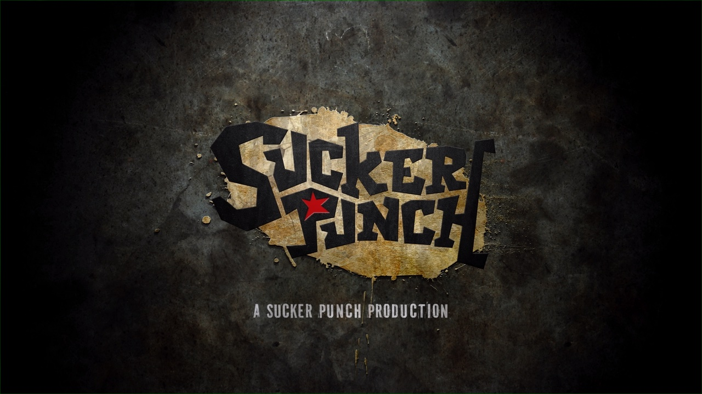](docs/screenshots/01-boot-sucker-punch-logo.jpg)<br>Boot: os logos dos estúdios | [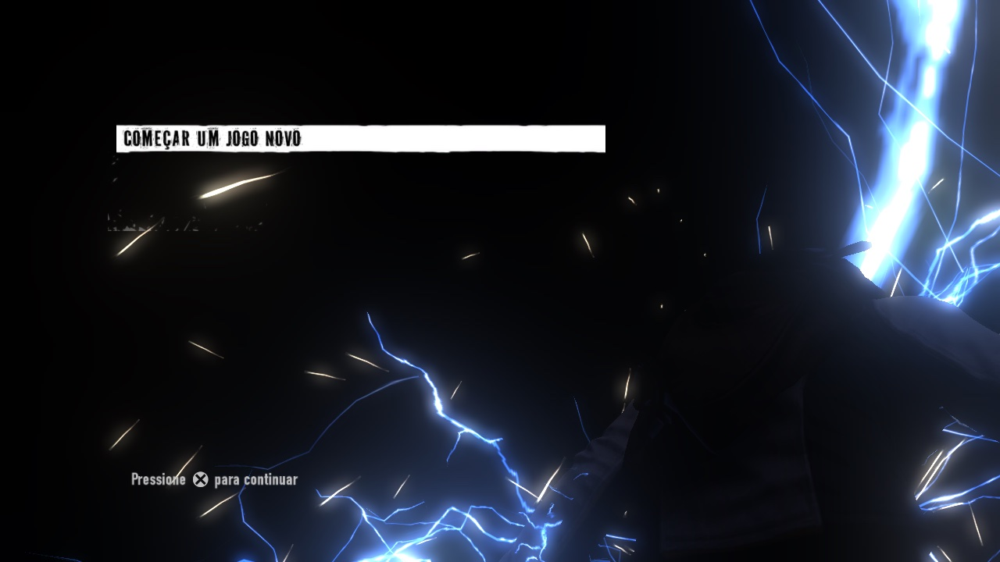](docs/screenshots/02-main-menu.jpg)<br>Menu principal 3D |
| [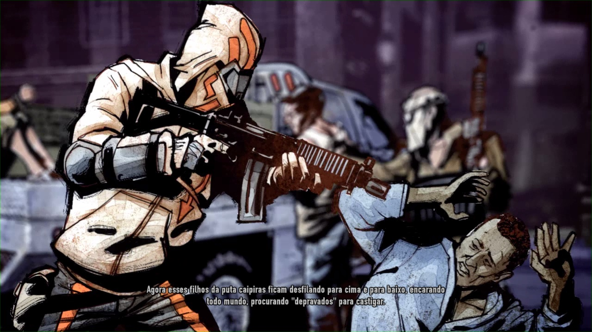](docs/screenshots/03-intro-comic.jpg)<br>Abertura em quadrinhos (vídeo Bink) | [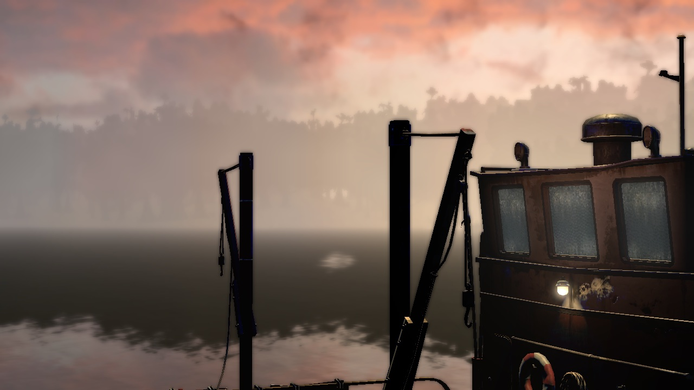](docs/screenshots/04-cutscene-sunset-docks.jpg)<br>Chegada a New Marais (cutscene no motor do jogo) |
| [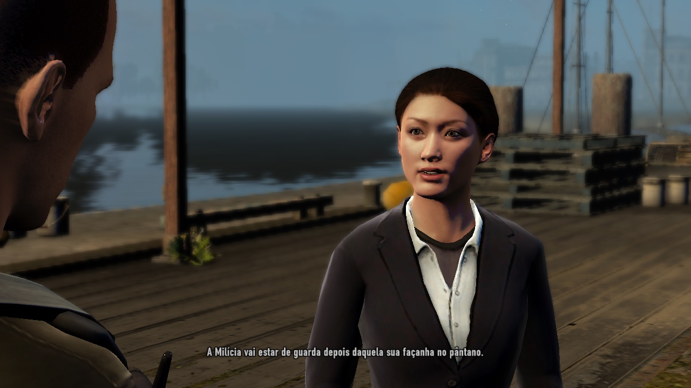](docs/screenshots/05-cutscene-kuo.jpg)<br>Kuo no píer (cutscene no motor do jogo) | [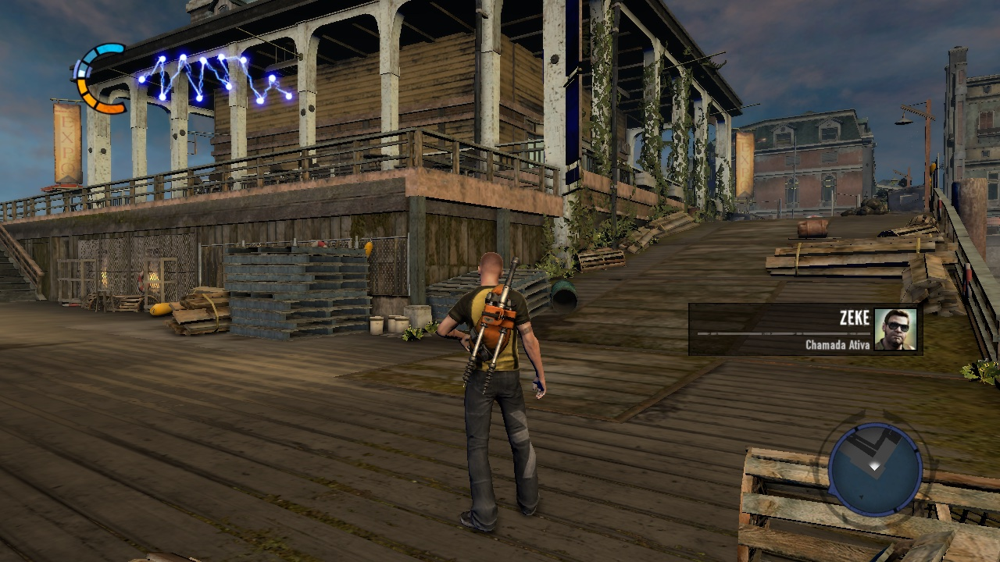](docs/screenshots/06-pier-gameplay.jpg)<br>Gameplay: o píer de dia |
| [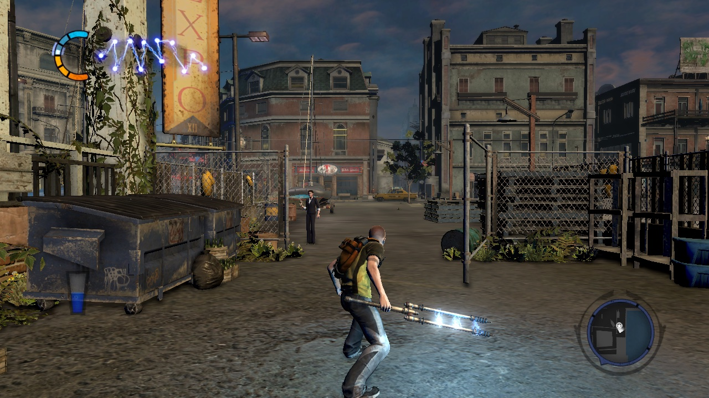](docs/screenshots/07-street-amp.jpg)<br>As ruas de New Marais, com o Amp na mão | [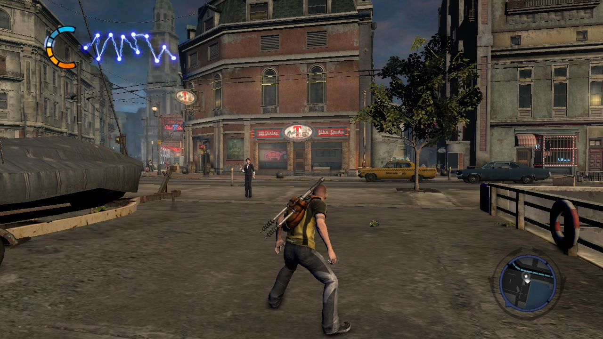](docs/screenshots/08-street-corner.jpg)<br>Fim de tarde na cidade |
| [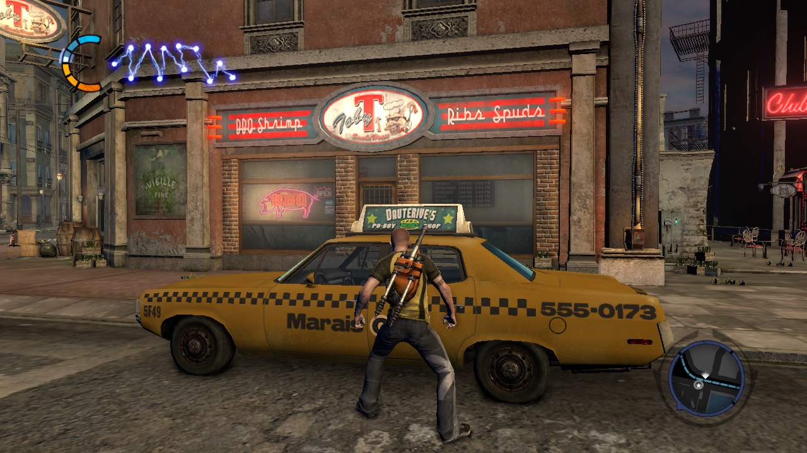](docs/screenshots/09-dusk-neon-taxi.jpg)<br>Neon ao entardecer |  |

<sub>Quadros do próprio port rodando num Mac com Apple silicon (M4 Pro),
montado a partir da cópia do próprio jogador, nos 1280×720 do jogo; as
legendas estão em português do Brasil, a dublagem padrão do port. inFAMOUS 2 ©
Sony Interactive Entertainment, desenvolvido pela Sucker Punch Productions;
mostrado só para documentar o port.</sub>

Construído sobre o [ps3recomp](https://github.com/sp00nznet/ps3recomp) e,
principalmente, sobre o **fork do inFAMOUS 1** do
[NoahBPeterson](https://github.com/NoahBPeterson/ps3recomp), que trouxe o
firmware em LLE e as correções que fizeram o primeiro jogo rodar no Mac. Veja
[CREDITS.pt-BR.md](CREDITS.pt-BR.md).

> [!WARNING]
> **Alpha, ainda não testado do começo ao fim.** O jogo roda do boot até as
> primeiras missões de New Marais, só no macOS com Apple silicon. Ninguém
> passou ainda de 1% da história, então missões mais adiante podem quebrar. O
> que falta está no [ROADMAP.pt-BR.md](ROADMAP.pt-BR.md).

> **Este repositório não contém o jogo, o firmware, chaves da Sony nem nada
> traduzido a partir deles.** Cada pessoa gera tudo localmente a partir da
> própria cópia legítima. Projeto de fãs, sem afiliação com a Sony Interactive
> Entertainment nem com a Sucker Punch Productions.

## Estado

| | |
| --- | --- |
| Boot, firmware em LLE, SPURS, áudio Wwise (jobs SPU) | ✅ |
| Aviso de saúde, logos dos estúdios, vídeos Bink, telas de loading | ✅ |
| Menu principal 3D, menu de pausa, opções | ✅ |
| Jogo novo → abertura em quadrinhos → cutscenes no motor do jogo | ✅ |
| Prólogo em Empire City (a Besta, o cargueiro) | ✅ |
| New Marais: primeiras missões, jogadas com janela e DualSense | ✅ |
| Desempenho | ✅ ~30 fps andando em New Marais (o limite do próprio jogo) nas execuções sem janela em Apple silicon: frames de 29,7–30,4 ms, folga de ~33–36 fps. Falta confirmar com janela |
| Controle (DualSense testado; DualShock 4 e Xbox pelo SDL), vibração | ✅ |
| Teclado e mouse (câmera no mouse, remapeáveis) | 🧪 mapeados, pouco testados com janela |
| Saves e troféus (em `~/Library/Application Support`), gerenciador de saves no app | ✅ |
| Dublagem e legendas em português do Brasil (padrão), outros idiomas que a sua cópia traz, DLC | ✅ |
| O app: instalar, recompilar, jogar, ajustes, controles, saves, reportar problema | ✅ [alpha v0.2.0](https://github.com/erikomis/infamous2-recomp/releases/tag/v0.2.0) |
| Jogo inteiro | ❓ ninguém passou ainda de 1% |
| Linux e Windows | ⏳ planejado |

Detalhes e próximos passos em [ROADMAP.pt-BR.md](ROADMAP.pt-BR.md).

## Baixar e jogar

Você precisa de um Mac com Apple silicon e da sua própria cópia do inFAMOUS 2
(a versão da PSN `NPUA80638`, por exemplo instalada no
[RPCS3](https://rpcs3.net) com a licença `.rap`).

1. Baixe o `infamous2-recomp_0.2.0_aarch64.dmg` da
   [release v0.2.0](https://github.com/erikomis/infamous2-recomp/releases/tag/v0.2.0)
   e arraste o app para Aplicativos. Ele não é notarizado: na primeira vez,
   botão direito > Abrir (ou Ajustes do Sistema > Privacidade e Segurança >
   Abrir Mesmo Assim).
2. O app lista o que ainda falta no seu Mac (Xcode Command Line Tools, alguns
   pacotes do Homebrew) e instala com o seu OK.
3. Escolha a pasta do jogo; o `.rap` é encontrado sozinho. A descriptografia
   usa o RPCS3 se você tiver, ou o seu próprio arquivo de chaves e o firmware
   do PS3 (uma pasta `dev_flash` ou o `PS3UPDAT.PUP` da Sony). Nenhuma chave
   vem com o app.
4. **Instalar** (a primeira recompilação leva alguns minutos), depois
   **Jogar**.

Depois de atualizar o app, o cartão de Atualizações na tela inicial oferece
**Recompilar o jogo**. A release não traz arquivos do jogo: o app recompila o
jogo no seu Mac.

## O app

[`launcher/`](launcher/README.md) é um app de desktop (Tauri) que faz tudo
isso sem terminal, com o visual do próprio jogo: Início (a arte da sua cópia,
JOGAR, ajustes rápidos, último save, estado), Gráficos, Desempenho, Jogo,
Controles e Avançado.

- **Instalar / recompilar** com barra de progresso: confere e instala as
  ferramentas, acha a sua cópia e o `.rap`, descriptografa com ou sem o RPCS3.
- **Gráficos:** janela, tela cheia ou sem bordas, tela, vsync, gamma, filtragem
  anisotrópica, FXAA, nitidez (CAS), ampliação MetalFX, contador de fps.
- **Controles:** remapeamento de teclado, mouse e controle, câmera no mouse,
  vibração; **áudio** (volume e saída); **idioma do jogo** (os que a sua
  cópia traz).
- **Saves:** listar, fazer backup, restaurar, importar/exportar com o RPCS3,
  `.zip`.
- **Reportar problema:** jogar em modo de diagnóstico, capturar um quadro,
  gerar um `.zip` para uma issue; **visualizador do log do jogo** que
  acompanha o log ao vivo.
- **Cartão de Atualizações:** avisa quando sai uma release nova ou quando o
  jogo instalado é mais antigo que as fontes do app, e oferece recompilar.

| | |
| --- | --- |
| [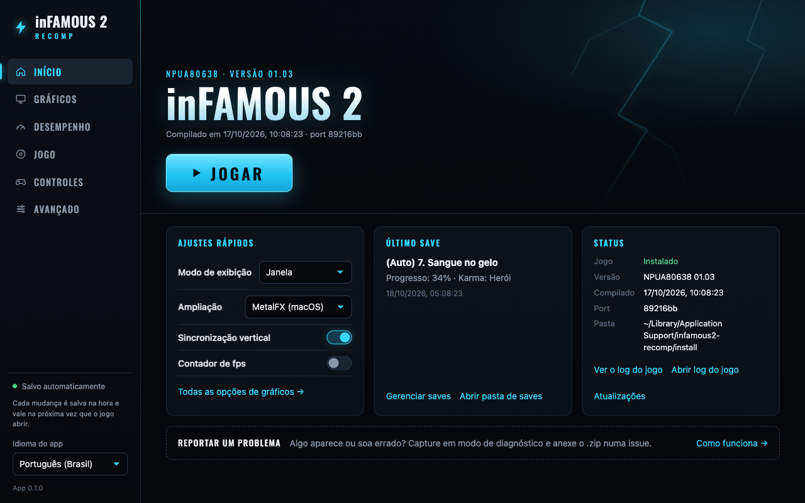](launcher/docs/screenshots/home.png) | [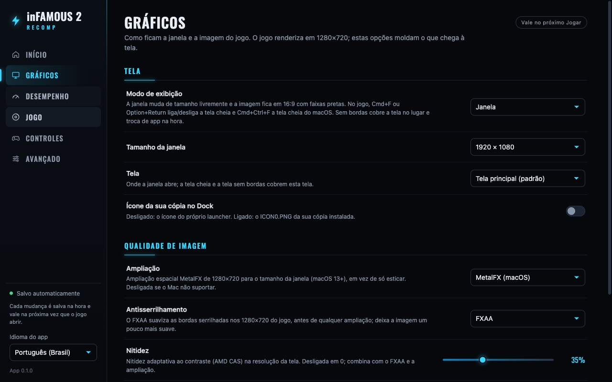](launcher/docs/screenshots/graphics.png) |

O CI gera o app para macOS, Windows e Linux a cada mudança (o jogo em si por
enquanto só compila no macOS); os instaladores ainda não são assinados.

## Problemas conhecidos

- Em algumas vistas de perto ao entardecer, os passes de occlusion volume
  deixavam fachadas inteiras (e o Cole) pretas; o `run.sh` os desliga por
  enquanto (perde-se só o escurecimento suave de contato perto de objetos)
  enquanto a conta deles é conferida. `PS3RECOMP_ENG_SKIP_FP=` (vazio) os
  desenha de novo.
- Raramente, um SPU rodando o job de geometria do Edge falha e o jogo para
  (cerca de 1 execução em 8 antes das últimas mudanças no runtime; nenhuma nas
  últimas 17 execuções de teste). Diagnosticado até um registrador
  sobrescrito dentro de um laço atômico, ainda sem correção garantida.
- Windows e Linux ainda não são suportados.
- Com menos de uns 3 GB livres no disco o jogo mostra um erro de "espaço
  insuficiente" no boot, que na janela aparece só como tela preta.

## Em andamento

O que está sendo feito agora (detalhes no [ROADMAP.pt-BR.md](ROADMAP.pt-BR.md)):

- Um **menu sobreposto dentro do jogo**, para mudar ajustes sem sair do jogo.
- Um **arquivo de alternância A/B ao vivo**: o jogo rodando relê um arquivo de
  texto e troca opções na hora, para comparar antes/depois numa mesma
  execução.
- Uma **quinta rodada de pull requests** para o
  [ps3recomp](https://github.com/sp00nznet/ps3recomp) com as correções do
  toolkit feitas neste port.
- **Correções adotadas do upstream:** ps3recomp #358, #340, #326, #349, #360,
  #366 e a correção dos limites de log da issue #364 entraram na v0.2.0; outras
  conforme forem saindo.

## Montar a partir do código

O app faz tudo isso por você; à mão, pelo terminal:

### O que você precisa

- Mac com Apple Silicon (testado num M4 Pro, macOS 27).
- Uma cópia legítima do inFAMOUS 2 instalada no [RPCS3](https://rpcs3.net),
  com a licença (`.rap`) e o firmware do PS3 instalados nele.
- Xcode Command Line Tools e Homebrew:

```sh
brew install cmake ninja sdl2 glslang spirv-cross spirv-tools python@3.12
python3.12 -m venv .venv
```

### Como montar

```sh
git clone https://github.com/erikomis/infamous2-recomp.git
cd infamous2-recomp
tools/setup_toolkit.sh                        # toolkit em ./ps3recomp-fork
.venv/bin/pip install -r ps3recomp-fork/requirements.txt
```

Depois um comando faz o resto (descriptografar, traduzir, compilar) a partir
da sua cópia e da licença dela:

```sh
python3 infamous2-lle/tools/rebuild.py --game "<RPCS3>/dev_hdd0/game/NPUA80638" --rap <NPUA80638...rap>
```

`--dry-run` lista as etapas e confere antes cada pré-requisito. Por padrão o
EBOOT e o firmware são descriptografados com o RPCS3; sem o RPCS3, passe o seu
próprio arquivo de chaves (formato scetool) com `--keys ARQUIVO` e o firmware
como o `PS3UPDAT.PUP` da Sony com `--firmware PS3UPDAT.PUP`. Nenhuma chave vem
com este repositório. A receita manual está em
[`infamous2-lle/README.md`](infamous2-lle/README.md#rebuilding).

A tradução leva poucos minutos e a compilação ~80 s num M4 Pro.

## Jogar pelo terminal

```sh
cd infamous2-lle
./run.sh
```

Um controle (DualSense testado) funciona direto. Teclado e mouse somam com ele:

| Tecla | PS3 |
| ----- | --- |
| W A S D | analógico esquerdo |
| I J K L ou mouse | analógico direito (câmera) |
| Setas | D-pad |
| Espaço | ✕ |
| Q / E / R | ○ / □ / △ |
| U / O | L1 / R1 |
| Y / P | L2 / R2 |
| G / H | L3 / R3 |
| Return / Tab | START / SELECT |
| Botão esquerdo / direito / do meio do mouse | R1 / R2 / L1 |

O mouse se ajusta com `PS3_MOUSE_SENS`, `PS3_MOUSE_INVERT_Y=1`,
`PS3_MOUSE_INVERT_X=1` e `PS3_MOUSE_DEADZONE`; `PS3_MOUSE=0` desliga. Um
clique no jogo captura o mouse (o cursor some e a câmera segue o mouse); Esc
ou Cmd solta, assim como trocar de app. `PS3_MOUSE_CAPTURE=0` volta para a
câmera sem captura.

Todas as associações acima podem ser trocadas num arquivo de controles: a
tela **Controles** do launcher grava esse arquivo, ou escreva à mão em
`~/Library/Application Support/infamous2-recomp/input.toml` (`input.ini`
também serve; `PS3_INPUT_MAP=<arquivo>` escolhe outro, `PS3_INPUT_MAP=`
nenhum). O que o arquivo não cita fica como na tabela acima (os botões laterais do
mouse apertam L1, como o do meio), só que uma entrada que o arquivo associa
sai dos controles que ele não cita: `cross = "Q"` tira o Q do ○ (cite nos
dois para manter nos dois). Os nomes não diferenciam maiúsculas, e um nome
desconhecido aparece uma vez no log e é ignorado.

```toml
[keyboard]                  # controle do PS3 = teclas
cross    = "Space"
circle   = "F"
start    = "Return, KeypadEnter"   # várias teclas
l3       = "Shift"
r3       = ""                      # sem associação

[mouse_buttons]             # controle do PS3 = botões do mouse
r1   = "Left"
up   = "WheelUp"            # cada passo da roda é um aperto
down = "WheelDown"
l1   = "Button4"

[mouse]                     # as variáveis de ambiente acima valem mais que estes
camera      = true
sensitivity = 1.5
invert_x    = false
invert_y    = false
deadzone    = 30
capture     = true

[controller]                # controle do PS3 = entradas do controle (SDL)
cross  = "a"                # ✕ no DualSense, A no controle de Xbox
circle = "b"
select = "touchpad"
```

- Controles do PS3: `cross circle square triangle l1 r1 l2 r2 l3 r3 start
  select`, `up down left right` (D-pad), `ls_up ls_down ls_left ls_right` e
  `rs_up rs_down rs_left rs_right` (analógicos).
- Teclas, pela posição num teclado Mac americano: `A`-`Z`, `0`-`9`,
  `F1`-`F20`, `Space Return Tab Escape Backspace ForwardDelete Up Down Left
  Right Home End PageUp PageDown`, `Minus Equal LeftBracket RightBracket
  Backslash Semicolon Quote Comma Period Slash Grave Section`,
  `Keypad0`-`Keypad9 KeypadEnter KeypadPlus KeypadMinus KeypadMultiply
  KeypadDivide KeypadDecimal KeypadEquals KeypadClear`, `Shift RightShift
  Control RightControl Option RightOption`, ou um código de tecla
  (`0x00`-`0x7F`). Cmd não pode ser associado, e Esc solta o mouse capturado
  antes de chegar ao jogo.
- Botões do mouse: `Left Right Middle Button4`-`Button8 WheelUp WheelDown`.
- Controle (nomes do SDL): `a b x y back guide start leftstick rightstick
  leftshoulder rightshoulder lefttrigger righttrigger dpup dpdown dpleft
  dpright touchpad misc1 paddle1`-`paddle4`; nomes de PlayStation e Xbox
  também valem (`cross`, `options`, `share`, `l1`, `r2`, `lb`, `rt`, ...). Os
  analógicos físicos sempre movem os analógicos do PS3.

A janela muda de tamanho livremente e a imagem mantém o formato 16:9, com
faixas pretas quando a janela tem outro formato.

| Atalho | O que faz |
| --- | --- |
| Cmd+F ou Option+Return | liga/desliga a tela cheia (sem bordas com `PS3_WINDOW_MODE=borderless`, a do macOS nos outros casos) |
| Cmd+Ctrl+F | liga/desliga a tela cheia do macOS |
| Esc / Cmd | solta o mouse |

**Modo Jogo.** No macOS a compilação gera um app,
`build/Infamous2Recomp.app` (`build/Infamous2Recomp` é um link para o
executável dele, e o `run.sh` o abre direto, então as variáveis e o log
funcionam como antes). O Info.plist dele diz que é um jogo, e assim o macOS 14+
liga o Modo Jogo enquanto o jogo está em tela cheia e na frente: prioridade na
CPU e na GPU, metade da latência Bluetooth para controles e AirPods. A tela
cheia do macOS liga o Modo Jogo; a sem bordas pode não ligar. O jogo também
impede o macOS de colocá-lo em App Nap. `PS3_QOS=1` (experimental) põe as
threads de PPU, SPU e RSX na classe de QoS mais alta; nos testes não aumentou o
fps e coincidiu com travamentos.

| Variável | O que faz |
| --- | --- |
| `PS3_WINDOW_MODE=windowed\|fullscreen\|borderless` | como o jogo abre: em janela (padrão), na tela cheia do macOS (um Space só dele) ou em tela cheia sem bordas (cobre a tela no lugar, sem barra de menus nem Dock, troca de app na hora) |
| `PS3_WINDOW_SIZE=<l>x<a>` | o tamanho da janela em pontos, p. ex. `1920x1080` (padrão 1280x720, reduzido para caber na tela) |
| `PS3_WINDOW_ICON=game\|<arquivo>\|none` | o ícone no Dock: por padrão o placeholder original do launcher (`infamous2-lle/window_icon.png`, sem arte da Sony); `game` usa o `PS3_GAME/ICON0.PNG` da sua própria cópia |
| `PS3_DISPLAY=<n>\|<nome>` | a tela em que o jogo abre, que a tela cheia e a sem bordas passam a cobrir: `1` é a da barra de menus, `2` a seguinte, ou o nome da tela como aparece nos Ajustes do Sistema (`DELL U2720Q`; sem diferenciar maiúsculas, ou só um pedaço). Padrão: a tela principal |
| `PS3_VSYNC=0` | apresenta os quadros sem esperar a atualização da tela (menos atraso, pode rasgar a imagem em tela cheia). O ritmo de 30 fps do jogo vem do próprio relógio de vblank e não muda |
| `PS3_ANISO=2\|4\|8\|16` | filtragem anisotrópica: chão e paredes vistos de lado ficam nítidos. Só mudam as texturas do jogo com mipmaps. Padrão desligada |
| `PS3_AA=fxaa` | FXAA na imagem de 1280x720 do jogo, antes de qualquer ampliação. Padrão desligado |
| `PS3_SHARPEN=<0..1>` | nitidez adaptativa ao contraste (estilo AMD CAS) na resolução de saída; 0 (padrão) desliga |
| `PS3_UPSCALE=metalfx` | ampliação espacial MetalFX de 1280x720 para o tamanho em pixels da janela (macOS 13+), em vez de só esticar a imagem. Onde não houver MetalFX, volta ao caminho normal com uma linha no log. Padrão desligada |
| `PS3_AUDIO_VOLUME=<0..100>` | volume geral (padrão 100). Aplicado ao que o Mac toca, numa curva que soa uniforme: 50 é cerca de −12 dB |
| `PS3_AUDIO_DEVICE=<nome>` | a saída de áudio, pelo nome nos ajustes de Som (sem diferenciar maiúsculas, ou só um pedaço: `AirPods`); não encontrada ou sem valor, a padrão do sistema (que o jogo acompanha quando muda) |
| `PS3_RUMBLE=0` | sem vibração no controle. Ligada por padrão: a vibração do jogo chega a controles DualSense, DualShock 4 e Xbox pelo SDL |
| `PS3_RUMBLE_STRENGTH=<0..200>` | intensidade da vibração em porcentagem (padrão 100); acima de 100 reforça as vibrações fracas, limitado ao máximo dos motores. `PS3_RUMBLE_LOG=1` mostra cada pedido que o jogo faz |

Saves e troféus ficam em `~/Library/Application Support/infamous2-recomp/gamedata`
(Linux: `~/.local/share/infamous2-recomp`), não importa de qual pasta o jogo é aberto;
o primeiro `./run.sh` com janela copia para lá um `infamous2-lle/gamedata` antigo.
`PS3_GAMEDATA_ROOT=<dir>` escolhe outro lugar.

Opções úteis:

| Variável | O que faz |
| --- | --- |
| `PS3RECOMP_ENG_GPU_SSAO=` (vazio) | devolve o job de SSAO para os SPUs (na GPU por padrão desde 2026-10-17: ~21 → 26–28 fps andando) |
| `PS3RECOMP_ENG_GPU_LIGHT=` (vazio) | devolve a iluminação para os SPUs (mais lento; por padrão ela roda na GPU) |
| `PS3_DISPLAY_GAMMA=<0.8..1.2>` | força o gamma da saída de vídeo; por padrão vale o brilho escolhido nas opções do jogo, como no console |

`tools/play_dump.sh <nome>` abre o jogo na janela e, a cada Enter no terminal,
salva aquele frame (render targets, shaders, log de passes) em `out/<nome>/`:
o jeito mais rápido de reportar um defeito de imagem.

Para testes sem janela: `tools/capture.sh <nome> <segundos>` salva um PNG do
frame a cada 10 s, `PAD_SCRIPT="95:0x4000"` aperta ✕ aos 95 s
(`760:0x0400:400` segura L1 por 400 s) e `PAD_STICK="lx,ly,rx,ry,de,até;..."`
segura os analógicos num intervalo (0–255, 128 = centro). Foi assim que o
tutorial foi jogado: ✕ aos 95 e 110 s para o menu, o analógico direito em
cada direção por 10 s a partir dos 470 s, depois o esquerdo, o esquerdo
para a frente a partir dos 640 s ("Head towards the disturbance") e L1
segurado com toques de R1 (`0x0800`) no portão do píer ("Hold L1 to aim").
`tools/play_prologue.sh [nome] [segundos]` faz tudo isso num comando só.

## Correções feitas aqui

No toolkit (em `infamous2-lle/patches/`, aplicadas pelo `setup_toolkit.sh`):

- **Lifter:** jump tables perdidas atrás de um epílogo com tail-call.
- **cellGcm:** o FIFO pulava comandos quando o jogo "estacionava" a GPU antes de religar o bloco; o menu congelava.
- **SPU:** o interpretador não voltava ao código traduzido dentro dos módulos de job WWS; o menu rodava a ~0,4 fps.
- **Fragment shaders:** os opcodes de pack/unpack do NV40 (PK4UB, UP4UB, PKG, UPG e os irmãos de 16 bits) não existiam no decompilador e eram pulados; o jogo os usa como conversão sRGB↔linear nos materiais de personagem, e sem eles o couro cabeludo do Cole saía verde e a pele com tons errados. Implementados seguindo o RPCS3.
- **Brilho:** a imagem saía escura e lamacenta, com personagens quase pretos em contraluz. O jogo pede ao RSX a conversão linear→sRGB ao escrever o framebuffer e a decodificação sRGB→linear ao ler texturas, e o motor ignorava as duas; portados os PRs #304 e #305 do upstream.
- **Devolvidas ao upstream:** seis destas correções entraram no ps3recomp
  v0.15.0 (#311–#316), e o README do ps3recomp cita este port na seção
  "In the community".
- **Upstream:** PRs abertos aplicados — #297, #275, #274, #278, #293, #303; #266, #302, #304 e #305 portados à mão (créditos em [CREDITS.pt-BR.md](CREDITS.pt-BR.md)).
- **Adotadas do upstream (2026-10-18, na v0.2.0):** #358 (origem da fonte do NV3089 em ponto fixo 12.4), #340, #326, #349, #360, #366 e o limite de log que dava a volta, da issue #364.

No port: extrator dos 27 módulos de job embutidos no EBOOT, registro do
policy module `Wws_Job`, PARAM.SFO no boot e scripts de execução e captura.

## Estrutura

| Pasta | O que é |
| ----- | ------- |
| [`infamous2-lle/`](infamous2-lle/README.md) | **Port atual.** Fork do inFAMOUS 1 + firmware em LLE. |
| [`infamous2/`](infamous2/README.md) | Primeira tentativa, contra o ps3recomp upstream v0.14.0 com SPURS em HLE. Para antes do primeiro frame; fica como referência. Suas pastas locais `game/`, `fw/` e `vfs/` também são usadas pelo port atual. |
| [`launcher/`](launcher/README.md) | O app de desktop (Tauri): instalar, recompilar, jogar, ajustes, saves. |
| `tools/setup_toolkit.sh` | Clona o fork no commit usado e aplica os patches deste repositório. |
| `docs/screenshots/` | A galeria do topo desta página. |

## Licença

Código deste repositório: MIT ([LICENSE](LICENSE)). O toolkit e o fork são
MIT dos seus autores. inFAMOUS 2 © Sony Computer Entertainment America LLC,
desenvolvido pela Sucker Punch Productions; projeto sem afiliação com a Sony.
