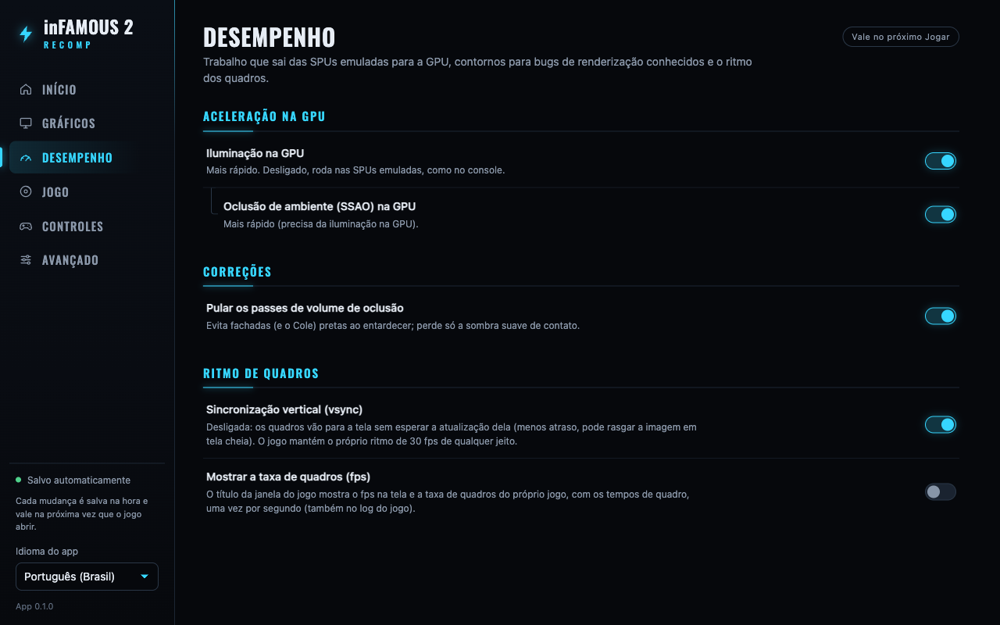
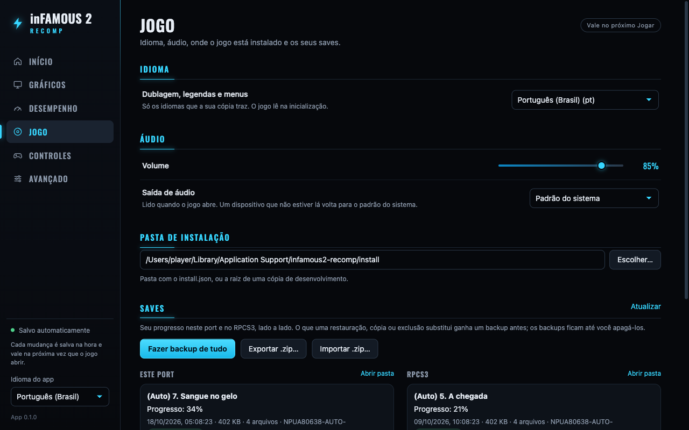
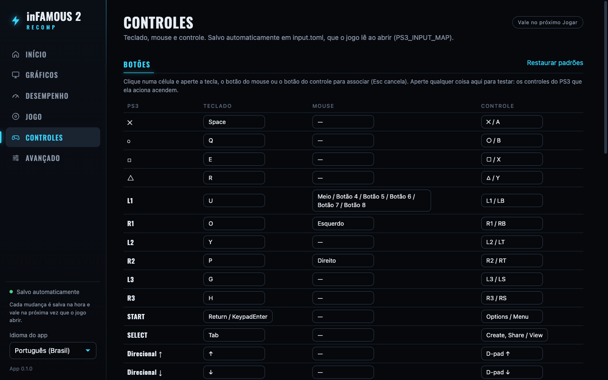
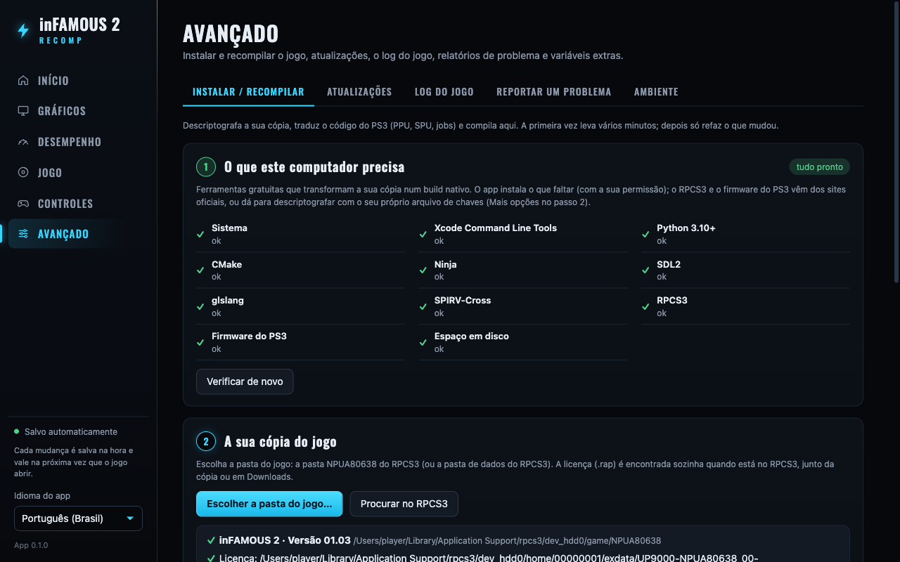
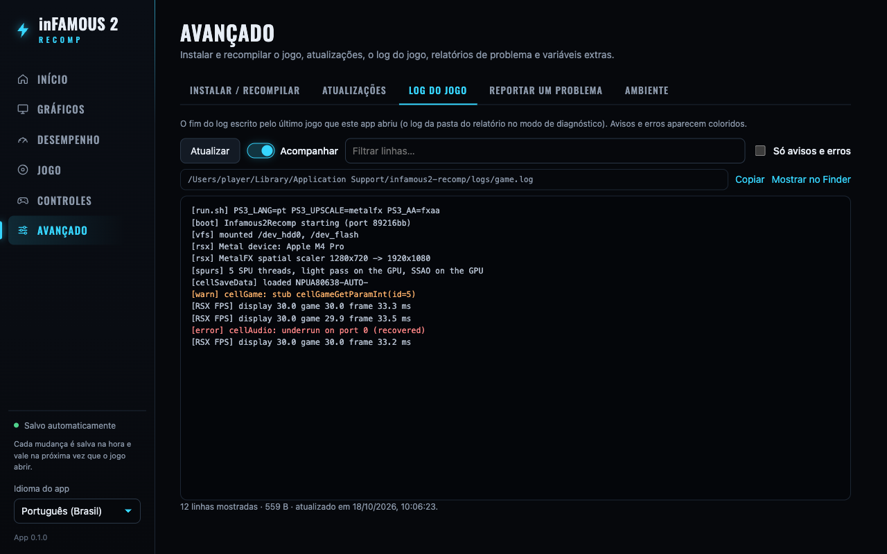
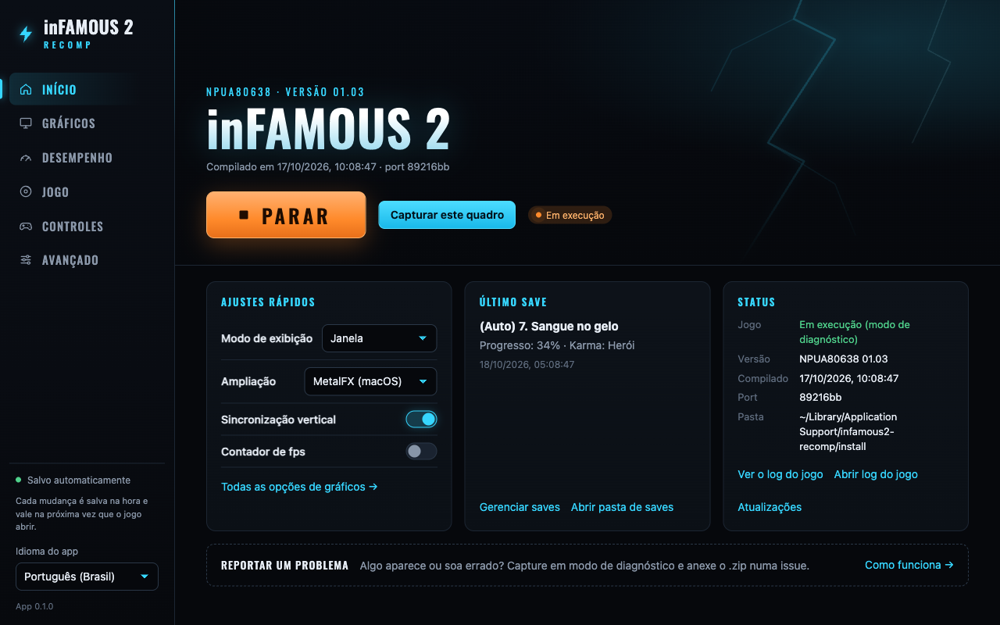

# Launcher (Tauri)

A desktop app that takes the player from their own copy of inFAMOUS 2 to
"Play" without a terminal: it runs the rebuild on the player's machine, shows
its progress, keeps the game's settings and starts the game. It ships no game
code or files; the cover art on the home screen is read from the player's
installed copy (`PS3_GAME/ICON0.PNG`, `PIC1.PNG`).

The game builds and runs on macOS only for now (Metal). The app itself is
built for macOS, Windows and Linux; on Windows and Linux it installs and
opens, shows that building and playing are not supported there yet, and
keeps the Install/Play buttons disabled (see "Other platforms" in the
roadmap).

## What the player does

1. Install the app (`.dmg` on macOS) and open it.
2. **Requirements**: the app lists what the machine still needs
   (`rebuild.py --check-json`) and, with the player's OK, installs it:
   - Xcode Command Line Tools: opens Apple's installer (`xcode-select
     --install`); the screen updates by itself when it finishes.
   - CMake, Ninja, SDL2, glslang, SPIRV-Cross, Python 3.12: `brew install`
     of exactly those formulae, output shown in the window. Without
     Homebrew the app shows the official install command and brew.sh.
   - RPCS3 (decrypts the copy once) and the PS3 firmware inside it: not
     bundled; the app explains and links to rpcs3.net. Or, without RPCS3:
     the player's own key file and the firmware as a `dev_flash` folder or
     Sony's `PS3UPDAT.PUP` (Advanced > Install / rebuild > More options >
     Decryption, below).
3. **Game folder**: pick RPCS3's `NPUA80638` folder (or RPCS3's data
   folder). If the game is installed in RPCS3 it is already filled in. The
   licence is found on its own: the app reads the content id from
   `USRDIR/EBOOT.BIN` and looks for `<content id>.rap` in every RPCS3 user's
   `exdata/` (the default RPCS3 folder and the one the copy sits in), next to
   the copy, and in Downloads, Desktop and Documents. Only when none is
   found does it ask for the `.rap` (under "More options", with PKG files,
   the install folder and the DLC key).
4. **Install** (Advanced > Install / rebuild; the app opens there while the
   game is not installed), then **Play** on Home.

## Screens

The look: dark only, near-black with electric cyan (Cole's lightning) as the
accent and warm orange for warnings and running states; headings and the side
nav in **Oswald** (SIL Open Font License, bundled in `src/assets/fonts/` with
`OFL.txt`, no CDN: the app works offline). A left sidebar with the title and
six pages; settings are rows with the text on the left and a switch, list or
slider on the right, under cyan section headers with a thin rule.

**Settings are saved the moment they change** (`launcher.json`,
`input.toml`) and apply the next time the game starts: the sidebar's
"Saved automatically" dot and each page's "Applies on the next Play" chip
light up on every save. There is no pending-changes Save button on purpose:
Play, the Updates card's rebuild and the requirements check all read
`launcher.json`, so unsaved edits would silently not apply.

Screenshots (1280×800, mocked backend, no game art: the fallback hero):

| | |
|---|---|
|  |  |
|  |  |
|  |  |
|  |  |

More in `docs/screenshots/` (English Home, not installed, each Advanced tab).

- **Home / Início**: a hero with the player's own art when it is there
  (`PIC1.PNG` behind, `ICON0.PNG` as the cover, read by `get_status` from the
  install, or from the game folder chosen in Install before the first rebuild;
  nothing ships with the app), else a plain styled title; the
  "NPUA80638 · version 01.03" line, build date and port commit; a big
  **Play/Jogar** (Stop in orange while the game runs; **Capture this frame**
  next to it when the game was started in debug mode). A bar under it
  when there is news from Updates (rebuild needed, newer app: **Download and
  install** with a progress bar, then **Restart to finish**). Then three
  cards: **Quick settings** (display mode, upscaling, vsync, fps counter: the
  same settings as the Graphics/Performance pages, kept in sync), **Last
  save** (title, progress, date; manage saves, saves folder) and **Status**
  (installed/running/debug mode, version, build, port commit, folder; links to
  the log viewer, the log file and Updates, and on macOS **Play shortcut on
  the Desktop**: see "The Play shortcut" below, and **Add to Steam** /
  **Remove from Steam** when Steam is installed: see "Add to Steam"). A
  strip at the bottom leads
  to Debug mode. Play first backs up the saves (see Saves).
- **Graphics / Gráficos**: Display (window mode `PS3_WINDOW_MODE`, size
  `PS3_WINDOW_SIZE`, screen `PS3_DISPLAY` from AppKit's screen names through
  `osascript`, "Your copy's icon in the Dock": see "The icon from your copy"
  below) and Image quality
  (MetalFX upscaling `PS3_UPSCALE`, FXAA `PS3_AA`, sharpening `PS3_SHARPEN`,
  anisotropic filtering `PS3_ANISO`, all passed only when not off; gamma
  override `PS3_DISPLAY_GAMMA`).
- **Performance / Desempenho**: GPU acceleration (light pass and SSAO on the
  GPU), Fixes (the occlusion-volume skip), Frame pacing (vsync `PS3_VSYNC=0`;
  the frame-rate counter `PS3RECOMP_METAL_FPS=1`: display fps, the game's own
  submission rate and frame times in the game window's title once a second,
  also as `[RSX FPS]` lines in the log).
- **Game / Jogo**: game language (`PS3_LANG`), audio (master volume
  `PS3_AUDIO_VOLUME`, output `PS3_AUDIO_DEVICE` from `system_profiler
  SPAudioDataType`), the install folder, and the **saves manager**: the game's
  save slots (`BCUS98125*`, `NPUA80638*`) in the port and in RPCS3 side by
  side (RPCS3 user picker when there are several), each with its icon, title,
  progress, date, size and whether its STATE matches the other side's. Back up
  one slot or everything, copy a slot RPCS3 -> port or port -> RPCS3, export
  the port's slots to a `.zip` or import one, delete a slot, and a list of
  backups to restore or delete. Every destructive action asks first. Details
  below ("Saves").
- **Controls / Controles**: a table of the PS3 controls with their key,
  mouse button and controller button. Click a cell and press what should
  drive it (a key, a mouse button or the wheel, a controller button, or pick
  the controller input from a list when the web view sees no pad); an input
  bound elsewhere on the same device moves to the new control, × unbinds,
  **Restore defaults** brings back the built-in layout. While the screen is
  open, the rows light up for whatever is held (keys, mouse buttons over the
  table, a controller through the Gamepad API): the button test. Saved at
  once to `~/Library/Application Support/infamous2-recomp/input.toml`, which
  Play passes as `PS3_INPUT_MAP` (format: the main README, "Playing"). Below
  it, the mouse options: camera on/off, sensitivity, vertical and horizontal
  inversion, dead zone, cursor capture (`PS3_MOUSE*`); then vibration on/off
  and its strength (`PS3_RUMBLE=0`, `PS3_RUMBLE_STRENGTH`), with a button that
  rumbles the controller through the Gamepad API; last, **Button icons /
  Ícones dos botões**: the glyphs in the game's prompts, Automatic (the device
  used last), PlayStation, Xbox or Keyboard and mouse (`PS3_BUTTON_ICONS`,
  passed only when it is not Automatic, so a choice made in the in-game menu
  is kept).
- **Advanced / Avançado**, five tabs:
  - **Install / rebuild**, three steps: the machine's requirements (with the
    installs above; a compact grid once everything is in place), the game
    folder (licence found automatically; PKGs, the `.rap`, the install folder,
    the decryption and the DLC key under "More options"), and the rebuild.
    **Check** runs `rebuild.py --dry-run` (requirements and plan, changes
    nothing); **Install** runs the rebuild with a progress bar, time estimate,
    step list and log; **Cancel** stops it and the tools it started.
  - **Updates**: whether the installed game was built from other port sources
    than the app carries (install.json's `port_commit` against the bundled
    `BUILD_INFO.json`, or the checkout's `git` HEAD in development), with
    **Rebuild the game**, which runs the Install tab's rebuild (only the steps
    whose inputs changed run again); and whether a newer app version is out
    (the release manifest `latest.json`, once per session when **Check for
    updates automatically** is on, the default, and on "Check again"), with
    its notes, **Download and install**, **Restart to finish** and a link to
    the release page. See "App updates" below; `INFAMOUS2_NO_UPDATE_CHECK=1`
    turns all of it off (`src-tauri/src/update.rs`).
  - **Game log**: the end of the log the last game this app started wrote
    (`logs/game.log`, or the session folder's in debug mode; at most the
    last 512 KB, cut at a line), read by `read_game_log`. Followed every 2 s
    while the tab is open, a text filter, "warnings and errors only",
    warnings in orange and errors in red, copy, show in Finder.
  - **Debug mode**: play with the problems logged, capture frames, analyse
    past sessions and pack them into a .zip; see "Debug mode" below.
  - **Environment**: extra environment variables, the equivalent command line,
    and Restore defaults.
- UI in Brazilian Portuguese (default) and English (sidebar), English as the
  fallback for a missing string.
- **In the game**, F1 (fn+F1 on a Mac keyboard), Insert or Cmd+, opens the
  in-game menu (L3+R3 together on a controller): picture, volume, vibration,
  mouse and a performance HUD, changed live and saved to `overlay.ini` next to
  `launcher.json`. A setting this app has away from its default is passed as a
  variable and wins over the menu's saved value at the next Play (main README,
  "In-game menu"). The Advanced page says so too.

## How it fits together

```
launcher (Rust, src-tauri/src/lib.rs)
 ├─ Install → python3 infamous2-lle/tools/rebuild.py --game … --rap … --out …
 │            reads its PROGRESS/STEP-*/CHECK/… lines (src/progress.ts)
 └─ Play    → /bin/sh <install>/infamous2-lle/run.sh, settings as env vars
```

- `rebuild.py` writes `<install>/install.json` (paths, version, commits); the
  launcher reads it. The default install folder is
  `~/Library/Application Support/infamous2-recomp/install`, next to the saves
  (`…/infamous2-recomp/gamedata`) that `run.sh` uses for windowed play.
- The install folder can also be the root of a development checkout (it must
  have `infamous2-lle/build/Infamous2Recomp`); Play then runs that tree's
  `run.sh` with its `../infamous2/vfs`.
- `run.sh` keeps every default. A setting only overrides it (`run.sh` uses
  `${VAR-default}`, so an empty value switches a default off).
- Settings live in `~/Library/Application Support/infamous2-recomp/launcher.json`;
  the game's output goes to `…/infamous2-recomp/logs/game.log`.
- The bindings live in `…/infamous2-recomp/input.toml` (`src-tauri/src/input_map.rs`
  reads and writes it). The launcher rewrites only `[keyboard]`,
  `[mouse_buttons]` and `[controller]` and keeps any other section as it was.
  The mouse options stay launcher settings passed as variables, which win
  over the file; if the file has a hand-written `[mouse]`, every mouse
  variable is passed so the screen's values are the ones that apply.
- The optional RAP key field (DLC only) is passed to `rebuild.py` in
  `PS3_RAP_KEY` for that run and never stored.
- **Decryption without RPCS3** (Advanced > Install / rebuild > More options): the method
  (`--decrypt-with auto|python|rpcs3`, default auto: the key file when one is
  chosen), the player's key file (`--keys`, scetool format) and the firmware
  (`--firmware`: a `dev_flash` folder, its `sys/external`, any folder with the
  three `.sprx`, or `PS3UPDAT.PUP`, from which the "pup" step extracts them;
  that needs the key file's PKG keys). Empty firmware = RPCS3's `dev_flash`.
  The three are remembered in `launcher.json` (the key file's path only; the
  app never reads or copies the keys itself). They go to both the
  requirements check (`--check-json`, rerun when they change, so a missing
  key file or the keys it lacks are listed with a "Choose the key file"
  button) and the run (`--dry-run` and the rebuild). The launcher drops an
  inherited `$PS3_KEYS`, so the screen is the only source. No key ships with
  the app or the repository.
- A GUI app on macOS starts with a minimal `PATH`; the launcher puts
  `/opt/homebrew/bin` and `/usr/local/bin` in front for the rebuild and the game.

## Debug mode (Report a problem)

`src-tauri/src/report.rs`, in Advanced > Debug mode (Home's hero also shows
**Capture this frame** while such a game runs). The player plays normally;
the game logs what goes wrong and a session index keeps the times, so a
person or an agent can go through the session afterwards with
`infamous2-lle/tools/log_triage.py`.

**Play in debug mode** starts the game as Play does, plus the variables of
`infamous2-lle/tools/play_dump.sh` pointed at a new folder
`…/infamous2-recomp/reports/<UTC time>/`: the texture log
(`PS3RECOMP_ENG_TEXLOG`), every pipeline's shaders with `manifest.txt`
(`shaders/`), the pass log on request (`PS3RECOMP_METAL_PASS_LOG=2`, flushed),
the whole frame every 120 presents (`frame.ppm`), the trigger file
(`PS3RECOMP_METAL_DUMP_TRIGGER=<report>/.dump-now`) and the FPS line. Unlike
`play_dump.sh` it sets `PS3RECOMP_METAL_SURF_DUMP_MIN=2000000000`, so the
first world frame is not dumped on its own: only captures are. On top of
that, the problem logs (`report::DEBUG_ENV`), none of which changes what is
drawn:

| Variable | What it adds to the log | Cost |
|---|---|---|
| `PS3RECOMP_ENG_FPSLOG=1` | per 10 s: frames that drew (world/light), presents with no draws, and where a present's time went | a clock read per present |
| `PS3_EDGE_WATCH=1` | the Edge geometry job's slot allocator checked after every runtime call; names the call when the rare Edge SPU fault starts | a 5-register compare per call in one SPU loop |
| `LV2_ERRDBG=1` | each syscall that fails, once per (number, error), at most 64 | one compare per syscall |
| `AUDIO_RATE=1` | every 5 s: mixed blocks vs real time, the silent share, frames the device dropped | a scan of one 256-sample block until a non-zero sample |
| `PS3RECOMP_ENG_DROPLOG=1` | draws the engine drops and why (6 per reason) | only on a dropped draw |
| `PS3_THREAD_DUMP=60` | every 60 s each guest thread and its call chain: the last dump before a hang shows what it waits on | ~30 lines a minute |

Always on anyway (no variable needed): unresolved HLE NIDs (once each),
texture binds that come out black (`PS3RECOMP_ENG_TEXFAIL`, first 48),
pipeline and MSL compile failures, `[cellGcmSys] ref stuck` FIFO stalls,
semaphore acquires given up, SPU faults and branches to 0, `[fs] open FAIL`.
Not used: `PS3_FTRACE` (a fixed window, written only at a clean exit),
`PS3_FSLOG` (a line per stat and read).

The game's log goes to `<report>/game.log` (Home's "Open game log" and the
log viewer follow it), and `system.txt` gets the macOS version, Mac model,
CPU, memory, GPU, the build's version and commits, and the variables
`run.sh` was given (home folder as `~`). `events.tsv` is the session index,
one tab-separated line per event (UTC time, Unix ms, the log's size then,
event, detail): `start`, `tick` every 2 s, `capture n=<n> frame=<present>
shot=<file>`, `taken` (the game consumed the trigger), `stop` (Stop pressed),
`exit code=<n>` or `exit signal=<n>`. When the game ends in a way the player
did not ask for, the launcher waits up to 20 s for macOS's crash report
(`~/Library/Logs/DiagnosticReports/Infamous2Recomp-*.ips`) and copies it as
`crash.ips`. A normal Play is unchanged.

- **Capture this frame** (while that game runs) touches the trigger: at its
  next present the game removes it and writes every render target to
  `surf/f<n>_h<handle>.ppm` and that frame's pass log to the log. The
  launcher also keeps the latest `frame.ppm` as `shots/shot<n>.ppm` and
  notes the capture in `captures.txt` and `events.tsv`, with the present
  count of the last frame dump in the log (`captured frame N`, to the
  nearest 120). The card shows the count of captures, surfaces and shaders
  and the folder's size, and "waiting" until the game has taken the capture.
- **Debug sessions** lists every report folder, newest first: date, length,
  how it ended (Stop, closed, crashed, crash report saved), captures, log
  and folder size, and the analysis when there is one.
  - **Analyse** runs `python3 -I log_triage.py <folder>` (the bundled port's
    copy, a development checkout's, or the install's) and shows its summary:
    errors, warnings, expected lines, problem counts by category and the top
    issues with their count and first/last time; **Open the analysis**
    shows `triage.md`.
  - **Create .zip** writes `reports/infamous2-report-<id>.zip` (and shows
    it): a fresh analysis first, then every file of the folder, the PPMs as
    PNG (converted in Rust, Sub filter + deflate; a capture is ~130-280
    surfaces, ~150-340 MB as PPM), text files (`.log .txt .md .json .tsv
    .ips`) with the home folder's path replaced by `~`, and the optional
    description as `notes.txt`. It can be attached to an issue or handed to
    the developer.
  - **Open folder**, **Show the .zip**; **Open an issue on GitHub** below.

### log_triage.py

`infamous2-lle/tools/log_triage.py <session folder | log>` (standard
library, Python 3.9+; `--selftest` runs it on a synthetic session) writes
`triage.md` and `triage.json` into the session folder (for a bare
`out/<name>.log`, `out/<name>.triage.md` / `.json`; `--out` picks another
folder). Lines are grouped by message with numbers and addresses masked,
with counts and first/last time, into crash (and the exit and crash report),
stall, shader (with the FP/VP hashes from `shaders/manifest.txt` and the
decompiler TODOs in the dumped shaders), texture (by format), SPU,
unimplemented (NIDs, stub syscalls), syscall errors, file system, audio,
draws dropped and other errors; plus fps and frame-time statistics, the last
thread dump when a stall or crash needs it, and each capture with the
problems from 10 s before to 3 s after and the log lines just before it.
Times come from `events.tsv`, else from the game's own timestamps (`t=` on
the frame-dump lines). Lines that match `log_triage_known.txt` (category |
regex | why) count as expected and stay out of the problem lists: the
missing patch and DLC psarcs, `ugc_message`, the boot-time FIFO wait, syscall
871, timeouts of waits that were given one, the offline network. A 1.5 GB
batch of real logs parses at ~40 MB/s.

## Saves

`src-tauri/src/saves.rs` (and `zipfile.rs`, a small zip reader/writer on the
`flate2`/`crc32fast` already in the tree). The port's saves are in
`<gamedata>/dev_hdd0/home/00000001/savedata` (`PS3_GAMEDATA_ROOT` from the
extra variables, else `…/infamous2-recomp/gamedata`, as `run.sh` sets it);
RPCS3's in `~/Library/Application Support/rpcs3/dev_hdd0/home/<user>/savedata`
(a custom `dev_hdd0` in RPCS3's `vfs.yml` is not followed yet).

- **Backups** go to `…/infamous2-recomp/save-backups/<UTC time>-<port|rpcs3>-<reason>/`
  (`savedata/<slot>/…`, `trophies/…` for a full port backup, `backup.json`
  with the date, reason, source, RPCS3 user and each slot's title). A backup
  is written to a hidden folder and renamed when complete.
- **Automatic backups**: before every Play (the port's slots and trophies;
  skipped when nothing changed since the last one; the newest N are kept,
  setting `saveBackupsKeep`, default 10, 0 = off), and before every restore,
  copy, `.zip` import and delete (those are never pruned). A delete without a
  successful backup does not happen.
- **Replacing a slot** builds the new one next to it and swaps it in by
  renaming; a failed copy leaves the old slot as it was. A restore puts a
  backup back where it came from (the port, or that RPCS3 user).
- **RPCS3 -> port**: the game's files byte for byte; RPCS3's binary PARAM.SFO
  becomes the `KEY=VALUE` text the port's cellSaveData reads (TITLE,
  SUB_TITLE, DETAIL, ATTRIBUTE, LIST_PARAM) and its `*<file>=1` keys become
  the port's PARAM.PFD (the files the game wrote as SECUREFILE, here STATE).
- **Port -> RPCS3**: the game's files byte for byte; when RPCS3 already has
  the slot its own PARAM.SFO is kept whole (only TITLE/SUB_TITLE/DETAIL follow
  the copied save) and any PARAM.PFD of its own stays; otherwise a new
  PARAM.SFO with the 14 keys RPCS3 writes for this game's saves. The port's
  PARAM.PFD is not copied.
- **.zip**: `<slot>/<file>` plus `infamous2-saves.json`. An import finds the
  slot folders anywhere in the archive (a zipped RPCS3 `savedata` works),
  skips other games, `__MACOSX` and paths that would leave the slot, converts
  an RPCS3 PARAM.SFO as above, and has size limits (64 MB a file, 256 MB in
  all, 4096 entries); no ZIP64 or encryption.
- **The game running**: every saves command refuses while the game the
  launcher started is running, or an `Infamous2Recomp` process started from a
  terminal; Play waits for a saves operation to finish. The screen warns when
  RPCS3 is open before a copy to it.

## Development

Needs Node 20+, Rust (stable) and the Xcode Command Line Tools. The rebuild
itself needs what `rebuild.py --dry-run` checks (Python 3.10+, CMake, Ninja,
SDL2, glslang, spirv-cross, RPCS3 with the firmware installed).

```sh
cd launcher
npm install
npm run tauri dev        # the app, with the frontend hot-reloaded
npm run tauri build      # .app and .dmg in src-tauri/target/release/bundle/
npm run typecheck        # frontend only
(cd src-tauri && cargo test)
python3 scripts/test_updater_json.py   # the updater manifest script
```

Two `cargo test` checks are ignored by default and run on files you give
them: `I2_VDF=<a copy of a shortcuts.vdf> cargo test real_file -- --ignored`
(round trip, add and remove on that copy; it writes `<copy>.added.vdf` next
to it) and `I2_ART_ICON0=<ICON0.PNG> I2_ART_PIC1=<PIC1.PNG> I2_ART_OUT=<dir>
cargo test art_from_files -- --ignored` (the four Steam images, to look at).

The screenshots in `docs/screenshots/` come from the built frontend in a
plain browser with a fake backend: `npm run build && npx vite preview --port
4173`, then load the page with `scripts/ui-mock.js` injected before it (for
example Playwright's `page.addInitScript({ path: "scripts/ui-mock.js" })`, at
1280×800). `window.__UI_MOCK__ = { running: true }` or `{ notInstalled: true }`
in an earlier init script shows those states. The mock has no game art.

In development the launcher finds `rebuild.py` relative to its own sources
(`../../infamous2-lle/tools/rebuild.py` from `src-tauri`); `INFAMOUS2_REPO=<repo>`
points it elsewhere. A packaged build finds it in its resources
(`port/infamous2-lle/tools/rebuild.py`, see below).
`INFAMOUS2_ANY_HOST=1` lets the launcher and `rebuild.py` try on a system
other than macOS (for work on the other ports).

## Packaging and releases

The bundles carry the port's own sources and tools, never anything from the
game. `scripts/stage_port.py` copies the git-tracked files `rebuild.py` needs
into `launcher/stage/port/` (ignored by git), in the repository's layout:

```
port/BUILD_INFO.json            commit the sources come from (no git in the bundle)
port/LICENSE, CREDITS.md
port/tools/setup_toolkit.sh     fetches and patches the ps3recomp toolkit
port/infamous2-lle/             CMakeLists.txt, main.cpp, ..., run.sh, config.toml
port/infamous2-lle/tools/       the *.py / *.sh rebuild.py copies (rebuild.py itself)
port/infamous2-lle/patches/     the toolkit patch
```

`src-tauri/tauri.bundle.conf.json` maps that folder to the `port/`
resource; it is passed with `--config` only when packaging, so `tauri dev`
and `cargo check` do not need the staging. `scripts/check_bundle.py`
unpacks every bundle (`.app`, `.dmg`, `.zip`, the updater's `.app.tar.gz`,
`.deb`, `.AppImage`, `.msi`, NSIS `.exe`; a `.sig` or `.json` next to them is
checked as it is) and fails on licences and keys (`*.rap`, `*.rif`, `act.dat`,
`*.edat`), game code and data (`EBOOT*`, `*.self`, `*.sprx`, `*.prx`,
`*.elf`, `*.pkg`, `*.psarc`, `*.pup`, `PARAM.SFO`, `NPUA80638*`, folders
`dev_hdd0`, `dev_flash`, `PS3_GAME`, `USRDIR`), the game's art and sound
(`ICON0*`, `ICON1*`, `PIC0*`, `PIC1*`, `PIC2*`, `SND0*`), lifted output
(`recompiled/`, `lle/`, `lle_spu/`, `jobmods/`), SCE/PKG/PSF/PSAR/NPD headers,
PowerPC or SPU ELF files and 320x176 PNGs (ICON0's size, under any name) by
content, any port file over 4 MB, and a missing
`rebuild.py`.

A local package (macOS):

```sh
python3 launcher/scripts/stage_port.py
cd launcher && npx tauri build --config src-tauri/tauri.bundle.conf.json
python3 scripts/check_bundle.py stage/port src-tauri/target/release/bundle/macos/*.app
```

### CI (`.github/workflows/launcher.yml`)

Runs on pushes to `main` and pull requests that touch `launcher/**`, the
staged port files (`infamous2-lle/*`, `infamous2-lle/tools/**`,
`infamous2-lle/patches/**`, `tools/setup_toolkit.sh`, `LICENSE`,
`CREDITS.md`) or the workflow, on `workflow_dispatch`, and on `v*` tags.

| Job | Runner | Bundles (artifact `infamous2-launcher-<job>`) |
|---|---|---|
| `macos-arm64` | `macos-14` | `infamous2-recomp_<ver>_aarch64.dmg`, `infamous2-recomp_<ver>_aarch64.app.zip`, and with the updater key `infamous2-recomp_<ver>_aarch64.app.tar.gz` + `.sig` |
| `windows-x64` | `windows-latest` | `infamous2-recomp_<ver>_x64-setup.exe` (NSIS), `infamous2-recomp_<ver>_x64_en-US.msi` |
| `linux-x64` | `ubuntu-22.04` | `infamous2-recomp_<ver>_amd64.AppImage`, `infamous2-recomp_<ver>_amd64.deb` |

Each job stages the port, runs the staged `rebuild.py --check-json` and
`--dry-run` (the host check must fail on Windows/Linux), type-checks and
builds the frontend, runs `cargo test` and `test_updater_json.py` (macOS,
Linux), builds the bundles,
runs `check_bundle.py` on them, writes `SHA256SUMS-<job>.txt` and uploads
everything (kept 30 days). npm and cargo are cached. A `v*` tag also sets
the app version from the tag (`vX.Y.Z`) and the `release` job creates a
**draft** GitHub release with all artifacts attached (or updates the draft
on a rerun); publishing it stays a manual step. With the updater key (below)
the macOS job also builds `infamous2-recomp_<ver>_aarch64.app.tar.gz` and its
`.sig`, and the release job adds `latest.json`; see "App updates".

### Signing (optional secrets)

Nothing is required: without secrets macOS gets an ad-hoc signature (the
first open needs right-click > Open, or System Settings > Privacy &
Security > Open Anyway) and the Windows installers are unsigned
(SmartScreen warns). With these repository secrets the workflow signs:

| Secret | Use |
|---|---|
| `APPLE_CERTIFICATE` | Developer ID Application certificate, `.p12` as base64 |
| `APPLE_CERTIFICATE_PASSWORD` | its password |
| `APPLE_SIGNING_IDENTITY` | e.g. `Developer ID Application: Name (TEAMID)` |
| `APPLE_ID`, `APPLE_PASSWORD`, `APPLE_TEAM_ID` | notarization (app-specific password); only used together with the certificate |
| `WINDOWS_CERTIFICATE` | code-signing certificate, `.pfx` as base64 |
| `WINDOWS_CERTIFICATE_PASSWORD` | its password |
| `TAURI_SIGNING_PRIVATE_KEY` | the app updater's minisign private key (the contents of the key file `tauri signer generate` writes); its public half is `plugins.updater.pubkey` in `tauri.conf.json` |
| `TAURI_SIGNING_PRIVATE_KEY_PASSWORD` | that key's password |

Only secrets that are set reach the build (Tauri would treat an empty
`APPLE_ID` as a request to notarize).

The icon is an original placeholder (`scripts/make_icon.py`, then
`npx tauri icon src-tauri/icons/app-icon.png`); no Sony art or logo.

### The icon from your copy

Graphics > "Your copy's icon in the Dock" (`gameIcon` in `launcher.json`, off
by default) is one switch for both Dock icons, macOS only:

- **The launcher** (`src-tauri/src/app_icon.rs`): the copy's own
  `PS3_GAME/ICON0.PNG` (320x176; from the install, else from the game folder
  chosen on Install, as the Home hero) is drawn centred, aspect kept, on a
  dark rounded square in Apple's icon grid (824/1024, the redesign's panel
  colours, a thin rim and a soft shadow) with the `png` crate, cached as
  `~/Library/Application Support/infamous2-recomp/app-icon.png` (plus
  `app-icon.png.src`, the source's path, size and mtime: a changed ICON0 is
  drawn again) and set with `-[NSApplication setApplicationIconImage:]` at
  every start, on a settings change and on a status refresh. When the copy is
  out of reach the cached icon stays; off gives the Dock the bundle's
  placeholder back. Only the Dock and the app switcher while the app runs:
  the bundle on disk keeps the placeholder.
- **The game window**: `PS3_WINDOW_ICON=game` as before; when the square
  icon is drawn, Play passes its path instead (`PS3_WINDOW_ICON=<file>`), so
  both Dock icons look the same. Without it the toolkit centres the bare
  ICON0 on a transparent square.
- **Use as the app's Finder icon** (under the switch, shown in a packaged
  `.app` when there is art): `-[NSWorkspace setIcon:forFile:options:]` puts
  the square icon on the installed `.app`, so Finder, Launchpad and a kept
  Dock item show it while the launcher is closed too; the same button takes
  it off again. macOS writes an `Icon\r` file at the bundle root and a
  `com.apple.FinderInfo` attribute on it. Checked on an ad-hoc signed test
  bundle: `codesign --verify --deep` still passes (codesign leaves `Icon\r`
  out of the seal), `--strict` fails only on the FinderInfo attribute, and
  `spctl` gives the same verdict as before (an ad-hoc app is "rejected"
  either way; the player has already let it through on the first start,
  before the button can be pressed). Taking the icon off makes `--strict`
  pass again. An app update replaces the bundle and so brings the
  placeholder back.

None of this art is in the repository or a bundle: `check_bundle.py`
rejects `ICON0*`/`PIC1*` by name and any 320x176 PNG by content.

## The Play shortcut

`--play` on the launcher's command line starts the game as soon as the window
is up, exactly as the Play button would (the saves backup, the saved settings,
the log), and the launcher stays open to follow it:

```sh
open -b io.github.erikomis.infamous2recomp --args --play
```

Home > Status > **Play shortcut on the Desktop** writes `~/Desktop/Play
inFAMOUS 2.app`, a tiny bundle whose executable is that one line
(`src-tauri/src/play_shortcut.rs`): it finds the launcher by its bundle id, so
it keeps working when the app moves. Its icon is the launcher's own `.icns`;
with "Your copy's icon in the Dock" on, the square drawn from the copy's
`ICON0.PNG` goes on it as a Finder icon at that moment (nothing from the game
ships). Pressing the button again replaces it; a file of the same name that
the launcher did not make is left alone. When the launcher is already open,
macOS only brings it to the front (the arguments of a second `open` are not
passed on), so press Play there. Steam or any other front end can run the
same `open` line; for Steam the launcher can also write the entry itself
(see "Add to Steam").

## App updates

The app downloads and installs its own new versions (`src-tauri/src/update.rs`,
`src/update.ts`, `tauri-plugin-updater` 2.14).

- **Where it looks.** `latest.json`, at the first of
  `plugins.updater.endpoints` (`tauri.conf.json`) that has one:
  `releases/download/updater/latest.json` (a fixed pre-release named
  `updater` that holds only that file), then
  `releases/latest/download/latest.json` (works once releases are published
  as normal releases instead of pre-releases, which GitHub's "latest" skips).
  The manifest lists only `darwin-aarch64`:
  `{"version", "notes", "pub_date", "platforms": {"darwin-aarch64": {"url", "signature"}}}`.
- **When.** Once per session when the app opens, if **Check for updates
  automatically** is on (`autoUpdateCheck` in `launcher.json`, on by
  default), and on **Check again**. Nothing is downloaded until the player
  presses **Download and install**. `INFAMOUS2_NO_UPDATE_CHECK=1` turns the
  check and the install off.
- **Install.** The plugin downloads the `.app.tar.gz` (progress on the card),
  verifies it against the minisign public key in `tauri.conf.json`
  (`requireSignedVersion`: the signature must name the announced version, so
  an old signed bundle cannot be passed off as a new one) and swaps the
  `.app` in place (an administrator prompt if the folder needs it). Refused
  while the game or a rebuild runs, from the `.dmg` (drag the app to
  Applications first), from a translocated copy (macOS runs a downloaded app
  from a read-only place until it is moved) and in a development build. Play
  and the rebuild wait while it installs; the rebuild also waits for the
  restart. **Restart to finish** relaunches into the new version, whose
  Updates card then offers **Rebuild the game** when the bundled port
  changed. A Finder icon set with "Use as the app's Finder icon" goes with
  the old bundle (press it again).
- **Releases.** On a `v*` tag, with the `TAURI_SIGNING_PRIVATE_KEY` secrets
  set, the macOS job passes `src-tauri/tauri.updater.conf.json`
  (`bundle.createUpdaterArtifacts`; only in CI, so a local `tauri build`
  needs no key) and gets the signed `.app.tar.gz`; the release job writes
  `latest.json` with `scripts/updater_json.py` (tested by
  `scripts/test_updater_json.py`) and attaches it to the draft. Players are
  offered it only once the release is **published**:
  `.github/workflows/updater.yml` (on `release: published`) copies that
  `latest.json`, with the published notes and date, to the `updater`
  release (made on first use), after checking that the version is the
  tag's, that the download is an asset of that release and that the
  signature names that version. It never moves players back unless run by
  hand (Actions > updater > Run workflow with a tag: the rollback). When
  removing the Windows/Linux files from a release, keep `latest.json` and
  the `.app.tar.gz` (+ `.sig`).
- **The key.** Made once with `npx tauri signer generate -w
  ~/.tauri/infamous2-updater.key` (password in
  `~/.tauri/infamous2-updater.key.password`). Back both up: without the
  private key no future release can be signed for the apps already
  installed, and they would have to be updated by hand once to a new key.
- **Trying a release.** Install the previous release's `.dmg` into
  Applications, open it, publish the new release, then Advanced > Updates >
  Check again: **Download and install**, **Restart to finish**, and the
  sidebar shows the new version.

## Add to Steam

Optional; nothing happens unless the player presses it. Home > Status >
**Add to Steam** (macOS app, shown when Steam is installed and someone has
signed in to it, and the game is installed) adds inFAMOUS 2 to the Steam
library as a non-Steam game, to start from Big Picture with the controller
(`src-tauri/src/steam.rs`, `vdf.rs`, `steam_art.rs`):

- **The entry.** Written into every account's
  `~/Library/Application Support/Steam/userdata/<id>/config/shortcuts.vdf`
  (binary VDF, read and written by `vdf.rs`; whatever it does not change is
  written back byte for byte, so other games' entries are untouched; tested).
  The file is copied to `shortcuts.vdf.infamous2-backup` first and replaced
  through a rename. `AppName` "inFAMOUS 2", `Exe` a Steam copy of the Play
  shortcut kept in the data folder (`steam/Play inFAMOUS 2.app`, whose
  script runs `open -W -b <launcher id> --args --play --exit-with-game`).
  The launcher starts the game and, with `--exit-with-game`, closes once the
  game ends normally (a crash or debug mode keeps it open); `open -W` waits
  for that, so Steam sees the game running exactly as long as it is and Big
  Picture comes back by itself. If the launcher is already open, it only
  comes to the front (press Play there). Pressing Add again brings the entry
  up to date and keeps what Steam or the player changed in it (play time,
  hidden, tags).
- **The app id** is Steam's own for non-Steam games: CRC32 of the quoted
  `Exe` followed by the name, top bit set. It names the art.
- **The art**, drawn at that moment from the player's own `ICON0.PNG` and
  `PIC1.PNG` (as the Home hero; nothing ships) into `config/grid/`:
  `<appid>p.png` (600x900), `<appid>.png` (920x430), PIC1 blurred and
  darkened with a cyan glow and ICON0 centred as a card with a cyan rim;
  `<appid>_hero.png` (1920x620, PIC1's upper part, which leaves out the
  audio trademarks printed lower down); `<appid>_icon.png` (the Dock icon's
  square, also the entry's `icon`).
- **Steam must be closed**: it keeps the list in memory and writes it back
  when it quits. While it runs the buttons offer **Quit Steam** (an
  AppleScript `quit`), wait for it to close, then go on.
- **Remove from Steam** takes the entry out (the others renumbered as Steam
  does, their contents untouched), deletes the four images it made and the
  Steam copy of the shortcut.

## The rebuild script on its own

```sh
python3 infamous2-lle/tools/rebuild.py --dry-run \
    --game "$HOME/Library/Application Support/rpcs3/dev_hdd0/game/NPUA80638" \
    --rap  "$HOME/Library/Application Support/rpcs3/dev_hdd0/home/00000001/exdata/<content id>.rap"
```

`--help` lists the options (`--out`, `--force`, `--from STEP`, `--only STEP,…`,
`--toolkit`/`--venv` to reuse existing ones, `--jobs`, `--nice`).

## Not done yet

- Internal resolution: the game renders at 720p (window modes, size, screen
  and vsync are in Graphics and Performance).
- The game still reads its options from environment variables; the plan is a
  `config.toml` the launcher writes and the game reads (see the roadmap).
- Signing: no certificates are configured yet, so macOS builds are ad-hoc
  signed and not notarized, and the Windows installers are unsigned.
- Building and playing on Windows and Linux: the app installs there but the
  game's renderer and window are macOS-only so far.
- In debug mode F12 in the game captures the frame (as "Capture this frame"
  does); a controller combo for it and a plain PNG screenshot key are not
  done. Old report folders are not cleaned up yet.
- Homebrew itself is not installed by the app (it needs the administrator
  password in Terminal); the app shows the command.
- From the God of War III PC launcher, not done yet: mods, a GUI scale
  option. (The "Play" shortcut, "Add to Steam" and app updates are done: see
  above; app updates wait for the next release to be tried end to end, and
  Add to Steam for a test with Steam's Big Picture.)
